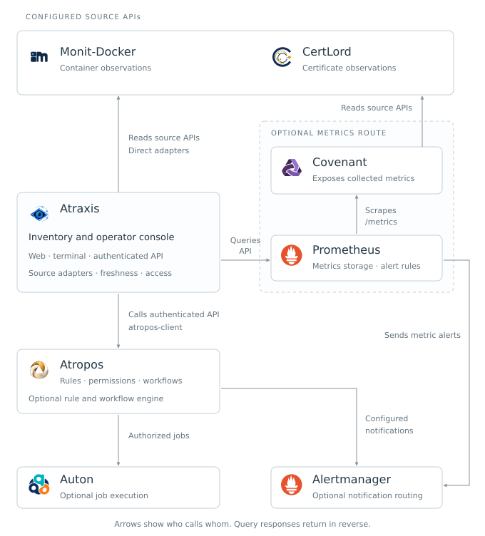
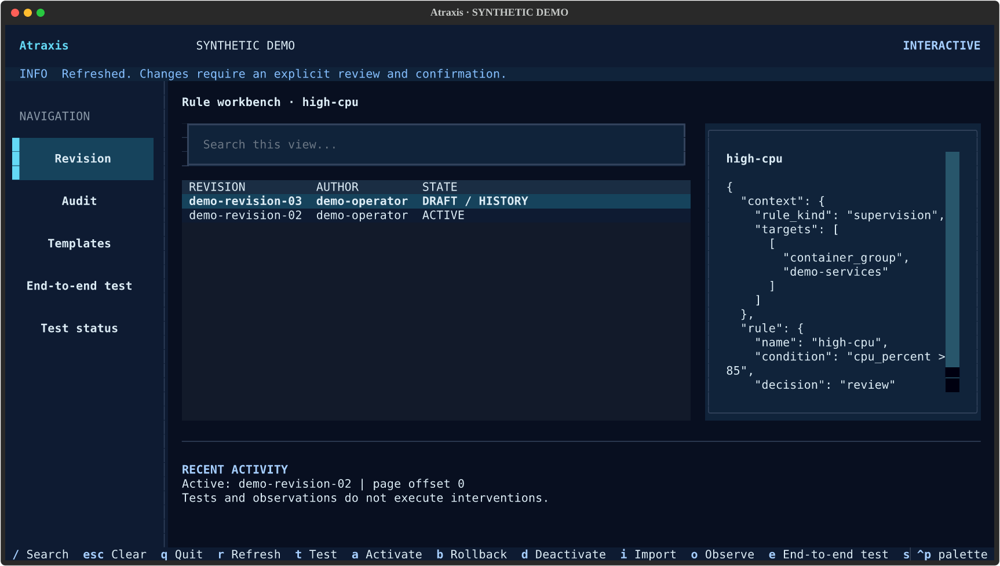

# Atraxis


**One console to inspect containers, certificates and metrics, then prepare and
test automation rules through the independent Atropos service.**

Atraxis **1.0.1** runs on your own infrastructure. It provides authenticated web,
command-line and Textual interfaces, with access scoped to your organizations and
resources. It distinguishes fresh observations, retained history and unavailable
sources instead of treating unknown values as zero.

[Website (EN)](https://atraxis.io/) · [Site (FR)](https://atraxis.io/fr.html) ·
[User guide](docs/README.md) · [Contributing](CONTRIBUTING.md) · [Roadmap](ROADMAP.md)

## How it fits together



**Arrows show who calls whom.** Atraxis reads the configured Monit-Docker and
CertLord APIs directly. Alternatively, Atraxis queries Prometheus; Prometheus
scrapes Covenant's metrics endpoint, and Covenant reads its configured source
APIs. Query responses return in the opposite direction: Prometheus does not push
inventory observations into Atraxis.

**Start with the direct adapters.** Neither Covenant nor Prometheus is required
for container or certificate inventory. Add Atropos when you need rule management;
Atraxis calls its authenticated API through `atropos-client`. Atropos can submit
explicitly authorized jobs to Auton and send configured notifications to
Alertmanager. Prometheus can also send metric alerts to Alertmanager separately.
Saving, testing or activating a rule never starts a workflow automatically.

## What you can do

- Inspect container, certificate and selected metric observations in one inventory.
- Search the resources you are authorized to read, with explicit freshness and
  source availability rather than an invented global health score.
- Create rule drafts, test exact revisions and review activation through Atropos.
  Saving, testing and activating a rule never dispatch an intervention by themselves.
- Manage access and configuration through reviewed, authorized operator flows.
- Use each underlying tool independently; Atraxis preserves its own local controls.

## Try the public demo

[Open the demo (EN)](https://atraxis.io/demo.html?lang=en) ·
[Ouvrir la démo (FR)](https://atraxis.io/demo.html?lang=fr)

No account is required. Read three real metrics from the public monit-docker demo,
collected by Covenant and Prometheus: inventory container count, HTTP collection
outcome and the source observation timestamp. This read-only view refreshes every
30 seconds and marks retained values as historical when collection fails or data
becomes old. Successful HTTP collection does not establish workload health.

The demo also shows Prometheus alert states and actual receipts from a local
Alertmanager webhook receiver. Its marked pipeline check uses a time-limited
synthetic signal; no email, SMS or chat notification is forwarded. See
[metric alerts and Alertmanager delivery](docs/prometheus-alerting.md) to configure
your own notification path.

A separate section lets you explore six synthetic resources, inspect retained
observations and try a local CPU-threshold example. These scenarios are not
connected to an Atropos engine and do not trigger interventions. The public feed
contains only selected numeric measurements and timestamps; private pilot pages
and APIs remain authenticated. Install Atraxis for the actual service-backed
inventory and rule-management interfaces.

## Release 1.0

`1.0.0` is the first stable Atraxis package for the documented reference profile.
See [supported configurations, limits and upgrades](docs/v1.0.md). Atropos engine and client **1.0.0** are now independently published on PyPI as
[`atraxis-atropos`](https://pypi.org/project/atraxis-atropos/1.0.0/) and
[`atropos-client`](https://pypi.org/project/atropos-client/1.0.0/). Atraxis 1.0.0
still pins client **0.1.0a10** for its optional `rules` extra. This `main` checkout
is **1.0.1** and pins the published client **1.0.0**. The engine is installed
in its own environment. See the
[component compatibility note](docs/v1.0.md#current-atropos-publication). Direct
Monit-Docker and CertLord adapters require neither Covenant nor Prometheus.

## Container image

See the [Docker image guide](docs/docker-image.md) for image availability,
configuration, persistent state and TLS. The initial stable image target is 1.0.1;
the publication workflow checks its stable source tag before pushing.

## Install from source

Requires Python 3.11 or 3.12. Start in a dedicated virtual environment:

```sh
git clone https://github.com/decryptus/atraxis.git
cd atraxis
git checkout v1.0.1
python -m venv .venv
. .venv/bin/activate
python -m pip install .
```

Follow the [operator journey](docs/operator-journey.md) to prepare login, scoped
access and recovery, then the [setup guide](docs/setup.md) before starting the daemon. To use rule
features, install the [independent Atropos client](docs/rule-remote.md#install-the-optional-client)
and connect to an explicitly configured Atropos service.

## Discover monit-docker in video

A three-minute tour of Docker monitoring, cron and serve modes, and the web and terminal interfaces.

- [Français — découvrir monit-docker](https://youtu.be/wPHl_Q2iyQs)
- [English — discover monit-docker](https://youtu.be/qyfNs5BTR3E)
- [All our videos on Decryptus](https://www.youtube.com/@decryptusHQ)

## Status

Atraxis 1.0.1 is stable for its documented reference profile, under GNU GPL version 3. It provides read-only HTTP collection, an in-memory inventory, an authenticated API and an optional web rule workbench. Readiness requires current observations from every configured source. The public demo remains experimental and read-only; the stable package does not imply a hosted production service, arbitrary deployment qualification or high availability.

A [remote rule service](docs/rule-remote.md), [local rule operator CLI/TUI](docs/rule-console.md) and [rule API integration](docs/rule-lifecycle.md) now support scoped drafts, tests and explicit active versions through an independent Atropos service. Atraxis contains no rule engine or rule storage. Rule control remains separate from inventory collection and executes no interventions.

## Source adapters and dependencies

**Use direct access by default:** `monit_docker` for containers and `certlord` for
certificates. Neither requires Covenant nor Prometheus. Prometheus is optional
for Atraxis inventory collection; each configured `kind` selects its read path.

| Adapter (`kind`) | Data path | Result | When to choose it |
| --- | --- | --- | --- |
| [`monit_docker`](docs/source-configuration.md#choose-an-adapter) | Monit-Docker → Atraxis | Native container and filesystem inventory | Default when Atraxis can reach the source API |
| [`certlord`](docs/source-configuration.md#choose-an-adapter) | CertLord → Atraxis | Native certificate inventory, including domains and fingerprints | Default when Atraxis can reach the source API |
| [`prometheus`](docs/prometheus.md) | Any configured exporter → Prometheus → Atraxis | Explicitly selected numeric metric series | Display metrics; Covenant is one possible exporter |
| [`prometheus_monit`](docs/prometheus-monit.md) | Monit-Docker → Covenant → Prometheus → Atraxis | Complete native container inventory and metadata | Centralized collection when direct source access is unavailable or intentionally restricted |
| [`prometheus_certlord`](docs/prometheus-certlord.md) | CertLord → Covenant → Prometheus → Atraxis | Complete native certificate inventory and metadata | Centralized collection when direct source access is unavailable or intentionally restricted |

Both complete inventory adapters through Prometheus require Covenant's dedicated
observation plugins. Prometheus and Covenant become required dependencies of those
configured sources. They preserve native identities and freshness rules, with
additional scrape/transport checks and delay. The generic `prometheus` adapter
provides metric resources; it does not reconstruct container or certificate inventories.

**Resources are discovered automatically within each source API's inventory.**
Configure one connection per upstream instance, not one per container or domain.
Covenant's observation plugins export every returned resource; additions, changes
and removals appear after collection, scraping and Atraxis polling. Numeric metric
selection with `prometheus` remains explicit. Inventory permissions and collection
limits still apply.

Direct inventory access can coexist with a separate Covenant/Prometheus path for
metric history and alerting. Choose one inventory route per upstream instance:
configuring both under different source IDs creates separate inventories, not
automatic deduplication or failover. A failed source retains historical data and
cannot supply current observations. Full observation transport also has
[explicit size and Prometheus storage costs](docs/prometheus-monit.md#capacity-and-operation).

A direct Covenant JSON relay into Atraxis is **not implemented**. The supported
Covenant observation path currently passes through Prometheus. See
[source configuration](docs/source-configuration.md) for credentials, limits and
adapter selection, and [metric alerting](docs/prometheus-alerting.md) for the
optional Prometheus → Alertmanager path.

## Related software

| Software | Role | When you need it |
| --- | --- | --- |
| **Atraxis** | Authorized inventory, web/CLI/Textual interfaces and rule-authoring gateway | The console installed here |
| [monit-docker](https://github.com/decryptus/monit-docker) · [Website](https://www.monit-docker.com/) | Container monitoring and autonomous local actions | To observe Docker resources |
| [CertLord](https://github.com/decryptus/certlord) · [Website](https://atraxis.io/certlord.html) | TLS certificate issuance, renewal and deployment | To observe managed certificates |
| [Atropos](https://github.com/decryptus/atropos) · [Engine package](https://pypi.org/project/atraxis-atropos/1.0.0/) | Rule lifecycle, permissions, persistence and guarded workflows | For the optional rule features; separate service |
| [atropos-client](https://github.com/decryptus/atropos/tree/main/client) · [Package](https://pypi.org/project/atropos-client/1.0.0/) | Python transport to the Atropos API | For rule consumers; respect each application's version pin |
| [Covenant](https://github.com/decryptus/covenant) | Export observations and numeric metrics | Optional; required for the two complete inventory adapters through Prometheus |
| [Prometheus](https://prometheus.io/) | Collect/store metrics and evaluate alert rules | Optional; required when choosing a Prometheus source adapter |
| [Alertmanager](https://prometheus.io/docs/alerting/latest/alertmanager/) | Group, route and deliver notifications | Optional metric/workflow notification path |
| [Auton](https://github.com/decryptus/auton) | Execute explicitly authorized jobs | Optional approved executor behind Atropos |
| [AnySQL](https://github.com/decryptus/anysql) | Database connection abstraction | Used by optional SQL account/storage adapters |

Each tool keeps its own configuration, credentials and protections. Atraxis does
not replace a source's monitoring, a metrics database, or Atropos's authoritative
rule storage. DWho, HTTPdis and Sonicprobe provide shared implementation libraries;
normal installation resolves the declared Python dependencies.

## Name

Adrien selected the name Atraxis on 4 October 2026. It is inspired by the Atraxi from Doctor Who. This project is independent of the historical `anatolsommer/atraxi` Node.js HTTP monitoring tool.

## HTTP daemon and YAML

Start with the [setup and diagnostic guide](docs/setup.md): `atraxis setup`
previews a validated starter configuration, and `atraxis doctor` explains local
configuration problems and optionally checks current source observations.

See [runtime configuration and Docker notes](docs-runtime.md). Install with `python -m pip install .`, validate with `atraxis check-config --config /etc/atraxis/atraxis.yml` and start with `atraxis serve --config /etc/atraxis/atraxis.yml`. Commands are explicit; no automatic TUI startup. Source collection runs with the daemon. Use `atraxis status` or `atraxis inventory` with a separate client configuration to consult the API; see [CLI usage and exit codes](docs/cli.md).

For a single-host installation, follow the [Docker Compose guide](docs/docker-compose.md).
It covers separate verified TLS connections, persistent data, cold restoration
and explicit guarded-worker profiles for simulation and approved execution.

Source destinations, credentials and collection budgets can now be checked offline;
see [source configuration](docs/source-configuration.md). The daemon periodically reads configured
sources and retains the last valid snapshot when a source fails.

The [bounded read-only HTTP transport](docs/http-transport.md) is implemented and tested with synthetic fixtures. See [collection and inventory](docs/collection-inventory.md) for scheduling, freshness, API fields and limitations.


## Documentation

- **Users:** [installation and diagnostics](docs/setup.md), [Docker Compose](docs/docker-compose.md), configuration and operation in the [user guide](docs/README.md).
- **Contributors:** [architecture, tests and development](https://github.com/decryptus/atraxis/blob/main/CONTRIBUTING.md).


## Textual terminal interface

See the [Textual guide](docs/textual.md) for installation, navigation and operation confirmations.

The capture below shows the actual interface with synthetic demonstration data.



## Web inventory

Open `/ui` on the running daemon to view authenticated source, container and
certificate and metric snapshots. The page distinguishes current, historical and unknown
observations and refreshes on request. See [web inventory](docs/web-inventory.md)
for access, navigation and the current read-only scope.

The optional [web rule explorer](docs/web-rules.md) reads rule history, active
state and revision YAML from Atropos using server-side account mappings and
engine-enforced permissions.

With an explicitly configured browser origin, the [web rule workbench](docs/web-rules.md#enable-draft-editing-and-scenario-tests)
also edits existing YAML drafts and runs scenarios against an exact revision.
Atropos owns validation, rights, versions and reports; saving or testing does not activate rules or execute actions.

[Draft editor preview](docs/images/web-editor-desktop.png) · [Scenario report preview](docs/images/web-test-report-desktop.png)

A passing report can open an explicit activation review. Confirmation pins the tested
revision and current active generation; Atropos enforces rights and records the change.

Optional [browser source configuration](docs/web-configuration.md) provides reviewed
source changes for explicitly authorized installation administrators. Defaults stay
disabled; saved changes require an explicit daemon restart.

The base package also offers [local source and inventory administration](docs/local-administration.md):
inspect, review and apply source changes or scoped read grants using an explicit
OS identity. CLI use does not require enabling web administration or installing Textual.

Use the offline [retention report](docs/retention.md) to inspect account archive
and configuration audit capacity without modifying evidence.

## Roadmap and license

See the [public roadmap](ROADMAP.md) for current capabilities and planned scope.
Project-owned code and documentation are licensed under GNU GPL version 3 only
([LICENSE](LICENSE), SPDX `GPL-3.0-only`). Dependencies retain their own licenses.
