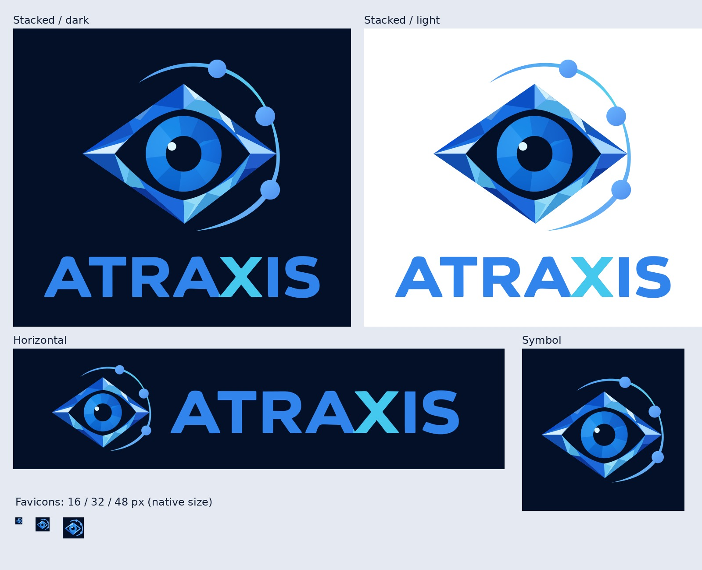

# Atraxis brand assets

Approved direction, 4 October 2026: blue crystalline eye, an orbital arc with three service nodes, blue **ATRA** and **IS**, cyan **X**. The project name is **Atraxis**, spelled `ATRAXIS` in the wordmark. Decryptus is the channel/persona identity; Atraxis is the software ecosystem.



## Choose an asset

| Use | File / directory |
| --- | --- |
| Main logo, transparent | `svg/atraxis-logo-stacked.svg` |
| Header, navigation, README | `svg/atraxis-logo-horizontal.svg` |
| Symbol only | `svg/atraxis-symbol.svg` |
| Text only | `svg/atraxis-wordmark.svg` |
| Fixed navy background | SVG files ending in `-dark.svg` |
| One-color reproduction | SVG files containing `-mono-navy` or `-mono-white` |
| Small interface icon | `svg/atraxis-symbol-small.svg` |
| PNG exports | `png/`, transparent plus white/navy background versions |
| Lossless web images | `webp/` |
| Vector artwork for layout/print | `pdf/` (RGB; no CMYK conversion) |
| Browser and mobile icons | `favicon/` |
| Social avatar | `social/atraxis-avatar-1024.png` |
| Open Graph / link preview | `social/atraxis-open-graph-1200x630.png` |
| Approved original image | `source/atraxis-approved.png` |
| Editable vector symbol | `source/atraxis-symbol-master.svg` |

## Fidelity and sources

The approved image is kept unmodified. The production SVG symbol is a clean vector reconstruction: its major facets and eye/orbit geometry follow the approved drawing; subtle raster shading is simplified. It is not a pixel-identical conversion. The wordmark contours are traced from the approved lettering, with flat blue/cyan fills. No font installation is needed to display the SVGs: all letters are paths. There are no embedded bitmap images, scripts, or external resources in the vectors.

Small icons and monochrome variants are deliberate optical simplifications. Use them below 64 px; do not squeeze the complete wordmark into a favicon. All standard PNG/PDF/WebP exports derive from the production vectors so that sizes remain consistent. `source/atraxis-approved.png` remains the reference for the exact approved raster appearance.

## Colors

| Role | Hex |
| --- | --- |
| Midnight background and pupil | `#031027` |
| Wordmark blue | `#3284ED` |
| X cyan | `#46C9EE` |
| Orbit / nodes | Blue through pale cyan; see vector master |

Keep generous clear space (at least half an iris diameter around the symbol). Do not stretch, recolor the X independently of the palette, add glow or metallic lettering, or replace the eye with an A. Prefer a plain dark or white background, not busy photography.

## Website integration

Copy the **contents** of `favicon/` into the site's public root. Keep its relative structure intact; the web manifest resolves icon paths relative to itself. Insert:

```html
<link rel="icon" href="/favicon.ico" sizes="any">
<link rel="icon" href="/favicon.svg" type="image/svg+xml">
<link rel="apple-touch-icon" href="/apple-touch-icon.png" sizes="180x180">
<link rel="manifest" href="/site.webmanifest">
<link rel="mask-icon" href="/safari-pinned-tab.svg" color="#3284ed">
<meta name="theme-color" content="#031027">
```

For a subpath deployment, prefix these URLs with that base path. The web manifest supplies branding only; routing, installation behavior and a service worker belong to the application. The Android icons leave sufficient space for maskable cropping. The ICO contains 16, 32, 48, 64, 128 and 256 px images; separate 16/32/48/64 PNGs are also provided. Apple touch icon: 180 px. Android icons: 192 and 512 px.

The repository is private and these assets do not publish the project or change the implementation status.

## Rebuild

From the repository root, with Python 3.12 and the Cairo system library available:

```sh
python -m pip install -r tools/brand/requirements.txt
python tools/brand/build.py
```

The optional overview sheet uses DejaVu Sans on Linux. The vector master and approved raster are the build inputs. Generated exports can be regenerated; edit the vector master for future geometry corrections. The SVG symbol uses local definition IDs; when inserting multiple copies inline into the same HTML document, prefix their IDs or use separate `` elements.
