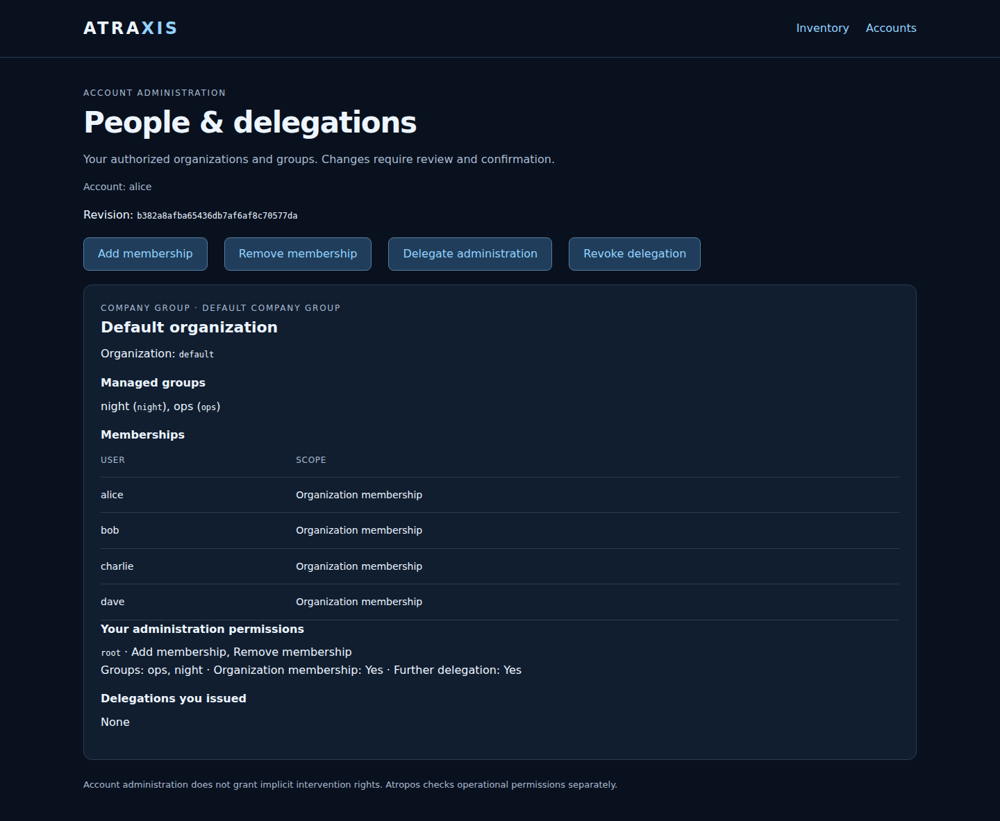
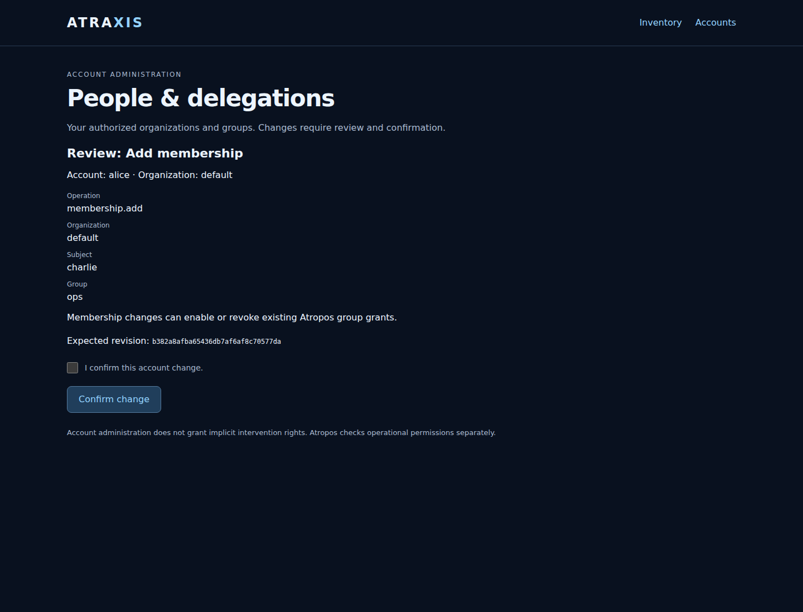
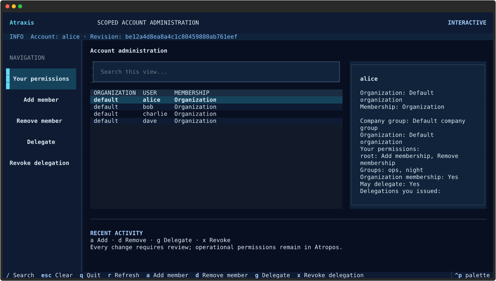
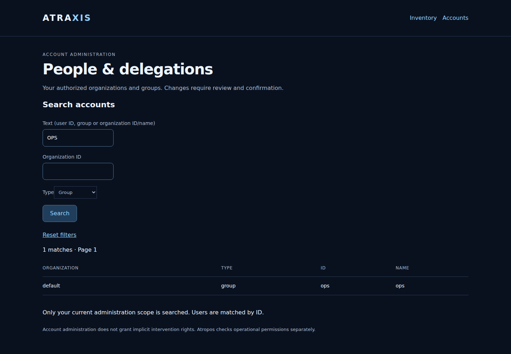
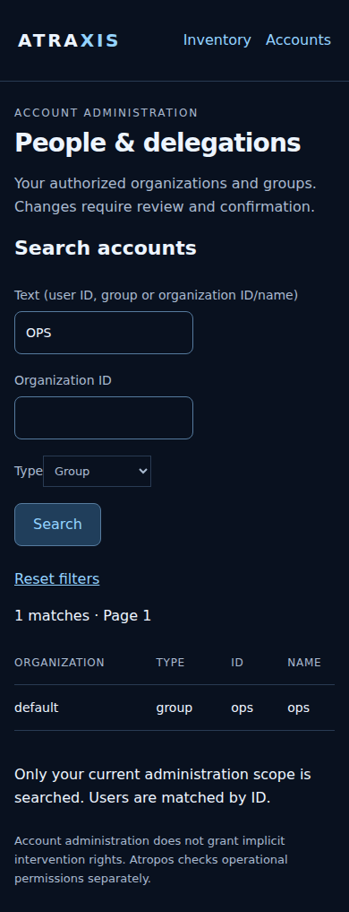
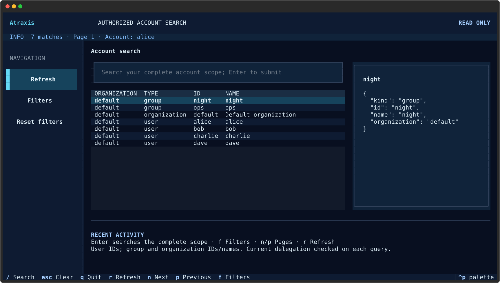

# Account directory

Atraxis can maintain one identity per person with memberships in multiple
organizations. A tenant represents a company group; organizations represent its
subsidiaries. Account groups and subgroups belong to one organization. They are
separate from server and container groups.

Trusted local administration bootstraps the hierarchy; delegated web/CLI/Textual
administration manages entities, scoped memberships and child delegations. The optional
[inventory access profile](web-inventory.md) adds organization selection and
source/server/resource read scopes. The [inventory grant editor](inventory-administration.md)
uses separate explicit administration bounds. Explicit organization selection is shared by inventory, rules and interventions.
Inventory-catalog editing remains a trusted local operation. Do not use this as a whole-product shared-hosting isolation boundary.

## Initialize and inspect

Use a dedicated private directory owned by the account running these commands.
The SQLite database and candidate files must be private regular files (mode 0600).
Paths cannot be final-component symlinks; the writable directory must be mode
0700. Administration uses local filesystem authority, not a tenant role.

```sh
install -d -m 700 ./private-accounts
atraxis accounts --store ./private-accounts/directory.sqlite3 init --subject alice
atraxis accounts --store ./private-accounts/directory.sqlite3 show
atraxis accounts --store ./private-accounts/directory.sqlite3 contexts --subject alice
```

Initialization creates a default company group and organization. It does not
create passwords, engine credentials or operational grants, and never overwrites
an existing snapshot.

## Review and apply

Export the editable directory, retaining the snapshot and its audit separately.
JSON and YAML candidates use the same exact schema.

```sh
umask 077
atraxis accounts --store ./private-accounts/directory.sqlite3 export > candidate.json
# Edit candidate.json, then review the changes and current revision:
atraxis accounts --store ./private-accounts/directory.sqlite3 check --file candidate.json
atraxis accounts --store ./private-accounts/directory.sqlite3 apply --file candidate.json \
  --expected-revision REVISION_FROM_CHECK --confirm
atraxis accounts --store ./private-accounts/directory.sqlite3 audit
```

`check` is read-only. `apply` requires the exact revision from review; competing
writers cannot overwrite each other silently. Removed entries remove memberships
only when all references are updated consistently. Prefer disabling a user to
retain its identity. Never reuse a subject or organization identifier for a
different person or organization: engine records are linked by these identifiers.

If an apply fails, inspect the current revision before trying again; do not retry
an uncertain outcome automatically. Directory, effective memberships and audit
commit together in one SQLite transaction. Supported storage is a local POSIX
filesystem; network filesystems are unsupported. For an offline filesystem copy, stop all readers and
writers and copy the complete private directory, including any SQLite journal
files. Do not copy a live database file on its own.

## Select account storage

SQLite is the default, with no database server. Connections use Sonicprobe AnySQL, supplied with Atraxis.
A plain `--store` path selects SQLite regardless of its filename extension.
The account administration and inventory profiles accept this storage mapping:

```yaml
store:
  backend: sqlite
  url: sqlite:///private-accounts/directory.sqlite3
```

Relative paths are resolved from the profile directory. An absolute URL uses
four slashes, for example `sqlite:////srv/atraxis/accounts/directory.sqlite3`.
CLI paths are relative to the current working directory. A missing `backend`
in a mapping defaults to `sqlite`; `url` is required. In-memory databases and
SQLite URI query options are not supported. Built-in adapters reject options.

For another installed adapter, select its name with `backend`, its connection
location with `url`, and optional adapter-specific settings with `options`.
Unknown or duplicate adapters fail closed; Atraxis never substitutes SQLite
when a selected adapter is unavailable. CLI selection uses
`atraxis accounts --backend NAME --store URL ...`. For adapter options, put the
`backend` / `url` / `options` mapping alone in a private YAML file and run
`atraxis accounts --storage-config storage.yml ...`; its relative URLs resolve
from that file. Do not combine `--storage-config` with `--store` or `--backend`.

To select the explicit JSON adapter, use `backend: json` with a current-format
snapshot in every Atraxis profile and `--backend json` for local commands.
All consumers must use the same authority. JSON and SQLite stores are not
converted automatically; unsupported prototype formats are rejected unchanged.

## SQLite format and search

SQLite schema **3** stores tenants, organizations, users, groups, memberships,
delegations and audit events in separate tables with foreign keys. Effective
memberships and authorized search projections commit atomically with those tables.
Search filters, totals and page selection run in SQL on the administrator's scope.
Subject, organization and kind use indexed selection; literal substring matching
still scans that authorized selection and is not a full-text index.

Fixed hexadecimal revisions use `CHAR(32)` and SHA-256 values use `CHAR(64)` with
explicit length/alphabet checks. Nonnegative integer columns have SQL sign/type
constraints. Audit row IDs auto-increment; their SQLite declaration must remain
`INTEGER PRIMARY KEY AUTOINCREMENT`, with a positive-value check.

Earlier prototype schemas are rejected without modifying their contents. These
applications are not deployed; initialize a new current-format store. There is
no migration tool and no automatic conversion or deletion.

## Directory schema

```yaml
version: 3
delegations: []
entity_delegations: []
tenants:
  - {id: company, name: Company group, enabled: true}
organizations:
  - {id: operations, name: Operations, tenant: company, enabled: true}
groups:
  - {id: operators, name: Operators, organization: operations,
     parent: null, inherit_parent: false, enabled: true}
  - {id: night, name: Night shift, organization: operations,
     parent: operators, inherit_parent: true, enabled: true}
users:
  - {id: alice, name: Alice, enabled: true}
memberships:
  - {user: alice, organization: operations, group: null}
  - {user: alice, organization: operations, group: operators}
```

IDs are globally unique within each entity type; names may repeat. Every group
membership requires an explicit organization membership. A child with
`inherit_parent: true` also includes its parent's effective members. Child
membership never confers parent membership. Inheritance defaults must be stated
explicitly. Disabling a group disables effective membership in its subtree;
disabling a user, organization or tenant prevents access in that context.

These memberships grant **no supervision, intervention or alerting permissions**.
Limits are 4,096 entries per entity type, 16,384 memberships, 16 group levels,
and the projection limits below. SQLite audit history has no fixed entry ceiling:
new writes append an audit row and read only the latest audit head. Explicit audit
export reads the retained history. JSON files remain limited to 8 MiB. No silent
pruning or rotation is implemented. The audit records
revision, previous revision, POSIX uid, timestamp and directory digest; it is not
a tamper-proof log against administrators who can directly rewrite the files.

## Require membership for rule access

Add the optional top-level field to the private browser rule mapping (version 1)
or local/remote rule gateway profile (version 2):

```yaml
accounts_file:
  backend: sqlite
  url: sqlite:///private-accounts/directory.sqlite3
```

The storage URL is relative to that profile. Keep the existing identity entries and
dedicated Atropos client credentials. Their `subject` and `organization` must
match an enabled membership. All browser, CLI, Textual and remote gateway rule
calls using this profile check the current directory before forwarding. A missing
or malformed configured directory fails closed. Browser calls also recheck
membership before returning the engine result.

Profiles without `accounts_file` keep their explicit identity mappings. To also
protect direct engine calls and queued work, configure the engine API and workers
to read the same live SQLite account projection:

```yaml
membership:
  backend: sqlite
  path: /srv/atraxis-accounts/directory.sqlite3
```

The engine opens the account database read-only through AnySQL and reads the
versioned membership tables without importing Atraxis. Missing files, unsupported
schemas and unavailable authorities deny access; no stale cached membership is
used. Use the matching engine with relational membership support. Keep account
files private and mount the containing directory read-only into engine containers.
Remote copies and network filesystems are unsupported. Atraxis does not learn the
engine's storage location or credentials.

Existing explicit JSON deployments can instead retain `backend: json` in Atraxis
and `membership: {backend: file, path: /srv/atraxis-accounts/directory.json}` in
Atropos. All consumers must use the same live authority, never a copied snapshot.

The JSON adapter writes account snapshot **format 3**, containing the directory,
audit and effective `membership` view, in one atomic replacement. Atropos reads only that versioned membership view,
without interpreting the Atraxis hierarchy. Never edit the projection manually.
The view allows at most 4,096 active subject/organization pairs and 65,536 group
references; an oversized projection rejects the update before replacement.
Earlier snapshot formats are explicitly rejected without alteration. Initialize
new stores using the current format; no prototype migration is provided.

With the authority configured, removing membership or disabling a user, tenant or
organization blocks direct engine access and queued real/test work at its next
authorization check. Engine grants can explicitly target effective account groups
using `subject_kind: group`. They still need domain, operation, resource and action
permissions; group membership alone grants none. Disabled groups affect their
subtree, and group-grant revocation is checked before every worker attempt.

Denied work is cancelled; repairing the file or re-enabling an account never
restarts it automatically. Missing/invalid authority files also fail closed and
cancel guarded work. Completed effects remain; revocation does not interrupt an
external action already started. An action can start in the check-to-action race
window, so no atomic distributed cutoff is claimed. Without engine configuration,
`accounts_file` alone remains an Atraxis gateway gate.

## Delegated administration: web, CLI and Textual

Directory format **3**, in account snapshot format **3**, adds bounded administration
delegations. The engine membership view remains version 1 and works through the JSON adapter
with the matching Atropos service. Earlier directory/snapshot formats are rejected.
No stored data is automatically migrated or deleted.

A trusted local administrator creates the users, tenants, organizations, groups
and initial delegations using `accounts export/check/apply`. For example, add this
top-level list to the directory (all referenced entities must already exist):

```yaml
delegations:
  - id: operations-admin
    subject: alice
    organization: operations
    groups: [operators, night]
    operations: [membership.add, membership.remove]
    organization_membership: false
    delegable: true
    enabled: true
    parent: null
```

This permits Alice to manage membership of those exact groups, and to issue
bounded child delegations. It grants no authority over other organizations,
global user identities, the hierarchy or engine permission definitions. If an
assignment affects inherited subgroups, all affected groups must also be within
one eligible delegation. Partial delegations are not combined to widen authority.

Child delegations must stay within their parent's organization, groups, operations
and organization-membership permission. Chains are limited to eight levels and
1,024 records; cycles and delegations back to an ancestor subject are rejected.
Disabling a parent delegation, parent administrator or its organization/tenant
invalidates the descendants. Revocation retains the records for review.

Administrators cannot change their own memberships. Membership changes affecting
any delegation holder require the trusted local administrator, even if that
holder's delegation has been revoked. This prevents indirect reactivation or
administrators increasing each other's rights through group membership. Creating
or editing global identities and hierarchy requires the separate entity permissions below.

### Map authenticated accounts

Create a private administration profile, separate from engine credentials:

```yaml
version: 1
store:
  backend: sqlite
  url: sqlite:///private-accounts/directory.sqlite3
identities:
  - {username: alice-login, subject: alice}
  - {uid: 1000, subject: alice}
```

The web server uses the authenticated HTTP Basic username; CLI/Textual use the
current OS uid. Callers cannot submit their acting subject. The profile and store
remain private files. CLI delegation is an application check, not protection
against a trusted OS account that can directly rewrite those files.

### Web administration

Enable both settings in the daemon configuration:

```yaml
general:
  auth_basic_file: users
  accounts_web_file: accounts-admin.yml
  accounts_web_origin: https://console.example.test
```

Keep your existing listener/proxy settings and verified HTTPS deployment. Origin
is the exact browser origin, with no trailing slash. Accounts appears in inventory
navigation. `/ui/accounts` shows only organizations, groups, memberships and
delegations within the current administrator's scope.

Choose **Add membership**, **Remove membership**, **Delegate administration** or
**Revoke delegation**, fill the form, review the exact request and confirm. Root
delegation IDs are shown under your permissions. Child delegation IDs appear
under the delegations you issued. Organization membership uses an empty group ID.

Review does not save. Confirmation is single-use and bound to the authenticated
account, profile and directory revision. Permissions are checked again under the
writer lock. A stale revision or revoked delegation requires a new review. If an
outcome is unconfirmed, inspect the directory/audit before retrying.

Membership changes can enable or revoke existing Atropos group grants. They do not
start an intervention. The engine keeps enforcing its own action/resource scopes.
Account mutation audit records include the acting subject, operation, organization
and target in addition to the local uid and snapshot revision. Local administration
can inspect this audit using `accounts audit`.

### CLI and Textual

```sh
atraxis accounts-admin --config accounts-admin.yml show
atraxis accounts-admin --config accounts-admin.yml tui
```

Textual uses `a` to add, `d` to remove, `g` to delegate, `x` to revoke and `r` to
refresh. Each action opens a form and a separate confirmation. Escape cancels.
Install the existing `textual` optional dependency for this interface.

For scripts, use a private YAML request file:

```yaml
operation: membership.add
organization: operations
subject: bob
group: night
```

```sh
atraxis accounts-admin --config accounts-admin.yml check --file request.yml
atraxis accounts-admin --config accounts-admin.yml apply --file request.yml \
  --expected-revision REVISION_FROM_CHECK --confirm
```

`membership.remove` has the same fields. `delegation.revoke` takes `operation`
and `grant`. `delegation.create` takes `operation`, `parent`, `subject`, `groups`
(list), `operations` (list), `organization_membership` (boolean) and `delegable`
(boolean). The server generates its new ID. No request can set the acting user,
create a root delegation, select a store or assign engine rule permissions.

The browser form store is bounded and process-local; multi-replica form sharing
is not implemented. Inventory has its own optional [read access profile and organization selector](web-inventory.md).
Account administration does not imply inventory or engine rights; whole-product
tenant isolation is not yet complete.

### Interface examples

These captures use synthetic users and memberships, never production accounts.







### Search accounts

Open **Search accounts** from the accounts page (`/ui/accounts/search`). Search
user IDs, group IDs/names and organization IDs/names. Text is a literal,
case-insensitive substring, not a regular expression. Select a type or supply an
exact organization ID; filters never expand your administration scope.

```sh
atraxis accounts-admin --config accounts-admin.yml search -q ops --kind group
atraxis accounts-admin --config accounts-admin.yml search -o operations --kind user --page 2 --limit 50
atraxis accounts-admin --config accounts-admin.yml search --tui
```

CLI output is JSON. Textual uses Enter to submit, `f` for filters, `n`/`p` for
pages, Escape to clear text, and **Reset filters** to clear all filters. Merely
typing does not filter a loaded page. Both interfaces search the complete current
authorized view before counting and paging (50 rows by default, at most 200).
The text limit is 128 characters. Users with several visible memberships appear
once per organization. User display names and users without a visible membership
are not searched by membership-only delegates. Explicit entity administrators also
search tenant IDs/names and the names of users within their entity scope, including
users without memberships. Global user/tenant results have an empty organization;
an organization filter excludes them. An unknown or inaccessible organization gives no matches.

The CLI/Textual profile maps the local OS UID; the browser maps the authenticated
username. Both use the same search service and current delegations. A changed
identity, directory revision or revoked authority fails the request; Textual
clears results rather than displaying cached data. Refresh explicitly. Search is
read-only and does not grant inventory or intervention permissions.








## Complete SQLite account backup and restore

Directory export is an editing format, not a complete backup. The dedicated
backup includes the current revision, complete audit chain and membership view.
The file is private (0600), checksummed and never overwrites an existing archive.
One SQLite read transaction gives a consistent snapshot while writers remain
available. The archive limit is 32 MiB / 100,000 audit entries; larger backups fail
explicitly rather than silently dropping history.

```sh
install -d -m 700 /private/backups
atraxis accounts --store /private/accounts.db backup --output /private/backups/accounts.json
```

Stop Atraxis and Atropos readers, writers and workers before restoration. Restore
the paired configuration, credentials, inventory grants and engine snapshot
separately. When a coordinated snapshot is needed, stop account administration
while capturing the account and engine archives. These archives are not encrypted.

```sh
atraxis accounts --store /private/restored-accounts.db restore \
  --input /private/backups/accounts.json --confirm-services-stopped
```

Restoration requires a new destination: existing databases, symlinks and SQLite
sidecars are refused. It rebuilds the current relational schema, validates the
entire audit chain and directory, and regenerates search/membership projections
before publishing a complete database atomically. Revision identities and audit
order are retained; no new administrative change or rule activation is invented.
Point all profiles and Atropos's read-only membership configuration to the
restored database, verify current rights and reconcile engine work before resume.
Restoring an older account archive may restore rights since revoked; review them
before reopening services. Neither service resumes automatically. No prototype
schema migration or JSON-to-SQL conversion is part of this command.


## Entity administration

Directory and SQLite schema **3** add explicit entity delegations. Bootstrap a
root authority on a new store using trusted local administration:

```sh
atraxis accounts --store ./private-accounts/directory.sqlite3 init --subject alice --administrator
```

Omit `--administrator` to initialize without administrative grants. The option
creates `root-entities` for Alice, with global scope and all entity and membership
operations. Existing stores are never overwritten. Map Alice in the private
administration profile shown above. For an existing current-format store, a trusted
local administrator can add an explicit root using `accounts export/check/apply`.

Web accounts offers create/update forms for users, tenants, organizations and
groups. Textual uses `e` to choose an entity operation and then opens the same
fields and a separate confirmation. To disable an entity, use its update form and
set **Enabled** to **no**. IDs are immutable. Organization tenant ownership and
group organization ownership cannot be transferred by an update. Group parent and
inheritance can change only within the administrator's scope and without cycles.

CLI requests use the same service, review and exact-revision confirmation:

```yaml
operation: group.create
entity:
  id: night
  name: Night shift
  enabled: true
  organization: operations
  parent: operators
  inherit_parent: false
```

`tenant.create`, `tenant.update`, `user.create` and `user.update` take `entity`
with `id`, `name`, `enabled`. Organization operations add `tenant`. Group operations
add `organization`, `parent` (ID or null), and `inherit_parent` (boolean). Updates
supply all fields. Creation assigns no memberships or operational permissions.

Delegate a smaller entity scope with this request:

```yaml
operation: entity_delegation.create
parent: root-entities
subject: bob
scope: {kind: organization, id: operations}
operations: [group.create, group.update, membership.add, membership.remove]
delegable: false
```

Scopes are `global` (null ID), `tenant`, `organization`, `group` (subtree), or
`user` (one global identity). User identities are shared across organizations;
an organization scope never grants global user editing. Membership operations
must be explicit and never follow from entity editing alone. One parent delegation
must contain the entire child scope and every operation. Chains have at most eight
levels and 1,024 records; cycles and delegation back to an ancestor are denied.
The recipient must be enabled and have a current membership appropriate to the
scope. Revoke an immediate child with `entity_delegation.revoke` and its `grant` ID;
its descendants immediately lose authority, while records remain available.

Administrators cannot expand their own effective memberships through hierarchy
edits. Membership changes to any administrator and reactivation of an inactive
administrative chain require trusted local recovery. An authorized administrator
can disable entities, including their own access; recovery does not happen
automatically. Neither entity permissions nor organization selection grant
inventory, rule or intervention permissions. Audit stores the exact operation,
actor and target; global entity events have a null organization.
