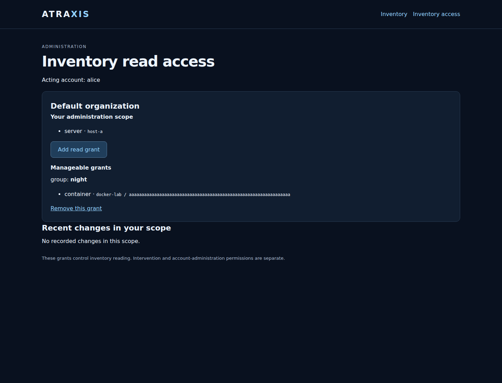
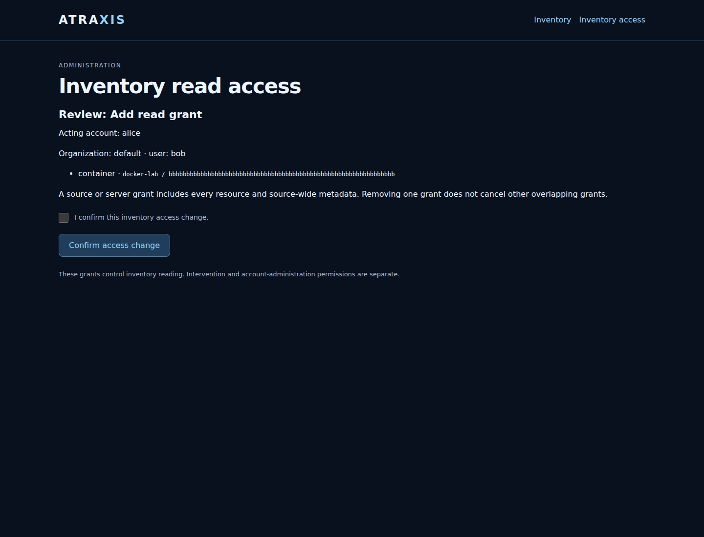
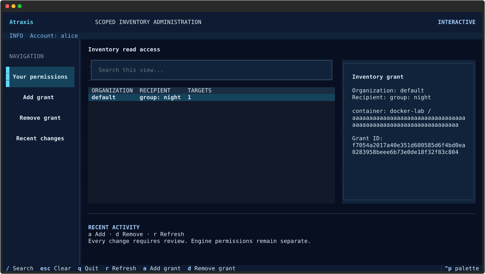
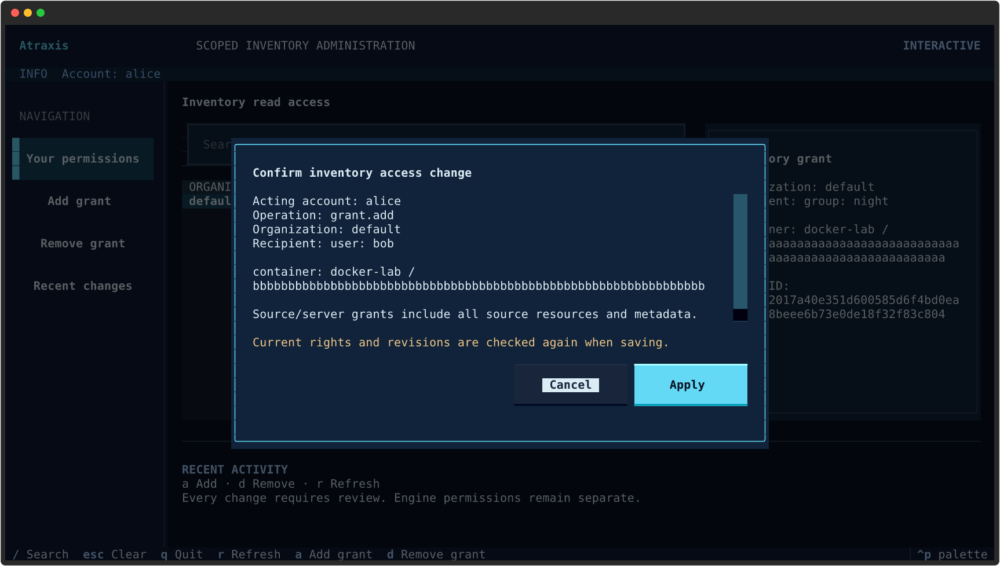

# Manage inventory read grants

The optional web, local CLI and Textual interfaces let authorized operators add or remove inventory read
grants without editing the profile by hand. They do not manage account membership, server/resource
catalogs or Atropos intervention permissions. It is separate from the account editor.

## Enable the editor

First configure the [version-3 inventory access profile](web-inventory.md). A trusted
local operator assigns explicit administration targets to a directory subject:

```yaml
version: 3
store:
  backend: sqlite
  url: sqlite:///accounts/directory.sqlite3
identities:
  - username: alice-login
    subject: alice
servers:
  - id: production-01
    organization: operations
    sources: [docker-production]
resource_groups: []
grants: []
administrators:
  - subject: alice
    organization: operations
    targets:
      - kind: server
        id: production-01
audit: []
```

Alice must remain an enabled member of `operations`. This authority lets her assign
or revoke read grants within `production-01`, including a grant to herself. It does
not confer read access automatically, authorize intervention, let her edit the
catalog or appoint other administrators. For narrower authority, use exact container
or certificate targets, or an existing resource group. There is one administration
entry per subject/organization. Whole sources and servers are intentionally broad.

Place the writable profile in a private directory owned by the service identity
(directory 0700, file 0600), on the same supported local POSIX filesystem as the
account store. Readers must see atomic file replacement: mount the containing
directory, not just the individual profile inode. The service needs write access to
both directories for their locks. Network filesystems are unsupported.

Enable routes with the exact public origin in the daemon configuration:

```yaml
general:
  auth_basic_file: users
  inventory_access_file: private/inventory-access.yml
  inventory_admin_origin: https://atraxis.example.org
```

Use the usual verified TLS reverse proxy. Literal-loopback HTTP is allowed for local
use. Without `inventory_admin_origin`, edit routes are absent. Restart the daemon to
change route/origin configuration; profile rights and memberships are reread on each
request. Basic authentication identities remain the existing daemon configuration.

## Add or remove a grant

Open `/ui/inventory-access` (also linked from the selected inventory page).
The page shows only administration scopes and grants wholly manageable within them.
A grant extending beyond your bounds is not shown or editable; ask a suitably
scoped administrator to handle it.

1. Choose **Add read grant** in the desired organization.
2. Enter the recipient type (`user` or account `group`) and its ID. A user must be
   an active organization member; an account group must belong to that organization.
3. Choose the target type and ID. Containers and certificates also require their
   source ID; other target types leave the source field empty. Use a resource group
   for several resources. The scope rules from the inventory guide still apply.
4. Review the acting account, organization, recipient and target.
5. Check **I confirm this inventory access change**, then confirm.

The current form adds one selector per grant. Additional grants are additive. To
remove a grant, choose **Remove this grant**, review it and explicitly confirm.
Other overlapping grants can retain access. Removing a group grant affects its
current and future members; a group grant can become effective later if group
membership or enablement changes. Neither operation launches an intervention.

A stale profile or account-directory revision requires a fresh review. Changing
the administrator's mapping, membership or authority can invalidate an open form.
Forms are single-use and process-local; multiple web replicas do not share them.
There is no automatic retry. If the result says **Outcome unconfirmed**, inspect
the current grants and recent changes before submitting anything again.

## Saved changes and history

A confirmed change replaces the profile and its audit event together. The file is
normalized to JSON (valid YAML); formatting and comments are not preserved. Keep
operator-managed configuration backups. There is no automatic data deletion.

Recent changes show the last 20 audit events still visible in your current scope.
Each saved event records actor, operation, organization, grant, time and the prior
profile digest. This history is not tamper-proof against the OS file owner and does
not automatically record manual file edits. Historical catalog references are
recorded as selectors, not frozen copies of every resolved resource. Unresolvable
or out-of-scope historical entries are hidden.

The profile is bounded to 256 KiB, 1,024 grants and 256 audit events. Reaching a
limit refuses further edits without deleting history. A trusted operator must
archive the full file and explicitly prepare the next configuration/history before
editing resumes; there is no automatic rotation.

All cooperating writers take the account-directory lock before the profile lock,
then recheck both revisions and authority. Trusted manual edits must coordinate
with the service or be performed while editing is stopped. Already delivered data
and in-flight reads are not recalled. The inventory reader continues to enforce
current rights on each subsequent request.

## Interface examples

These captures contain synthetic identities and resources only.





[Mobile administration](images/inventory-admin-mobile.png)


## Local Textual editor

The base package also provides `show`, `check` and `apply` using the same local
identity and authority. See [local administration](local-administration.md) for
request examples, exact review revisions and failure handling. Textual is not
required for those commands.

Install the optional terminal dependencies with `pip install '.[textual]'` from
the source checkout. Add an explicit OS UID mapping to the **same version-3
inventory profile**; obtain the numeric ID with `id -u`:

```yaml
identities:
  - username: alice-login
    subject: alice
  - uid: 1000
    subject: alice
```

Replace `1000` with the intended trusted operator's UID. A web username mapping
alone cannot authorize the terminal, and `USER`/`LOGNAME` environment variables
cannot override the UID. The mapped subject still needs explicit inventory
administration targets and active membership. There is no `--actor` override.
A changed mapping invalidates an open review.

```sh
atraxis inventory-admin --config /path/to/private/inventory-access.yml tui
```

This is a **local trusted-operator** tool, not a remote administration client.
It needs the same local profile, account store and lock-directory permissions as
the web writer. File owners can edit the underlying configuration outside the UI;
this interface is not an OS privilege boundary. Do not loosen private file modes
to share it among untrusted OS users. No web origin setting is needed for local use.

Press **a** to add a grant, **d** to remove one, and **r** to refresh. The add form
asks for organization, recipient and one target selector. For removal, copy the
exact grant ID shown in its row details. Both flows show a separate review; Escape
cancels without writing. **Apply** checks current authority and both revisions
again. Recent changes in the navigation shows the last 20 scope-visible events.
A failed or uncertain operation clears the stale view and never retries; refresh
and inspect history before preparing another change.




