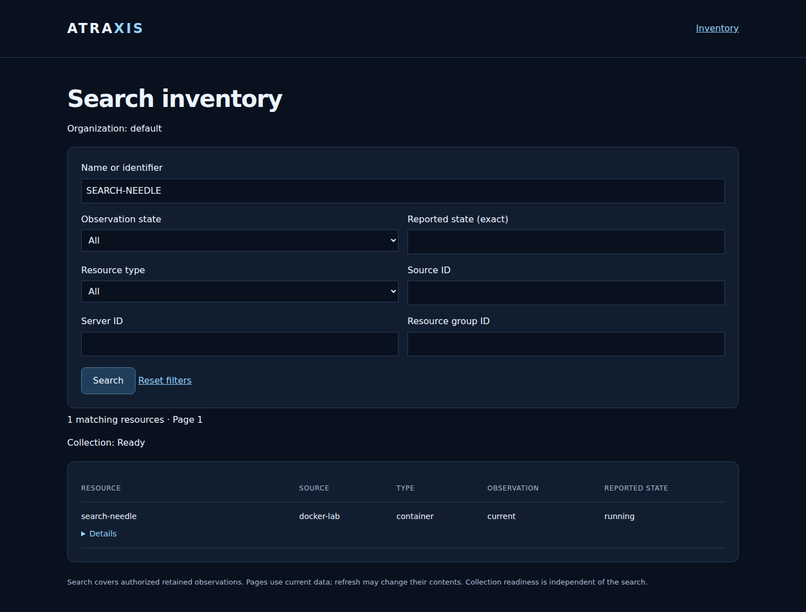
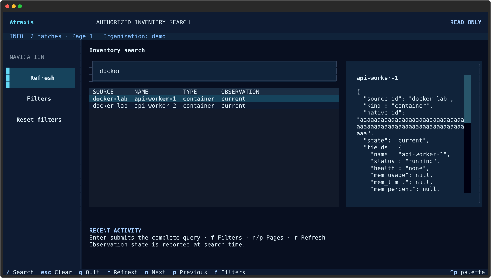

# Search inventory

Open **Search inventory** from the inventory page, or visit `/ui/search`.
Choose an organization when your account has more than one. Search uses the same
live membership and read grants as inventory; it cannot widen your access.

The service searches all authorized retained observations before counting and
pagination, including resources beyond the inventory page's 200-row display limit.
It uses bounded in-process filtering; no separate search server, index or credentials
are required. Results come from collected snapshots, not new upstream requests.

## Fields and filters

| Field | Meaning |
| --- | --- |
| Name or identifier (`q`) | Case-insensitive substring of resource name, certificate domain, selected metric label value, native resource ID or source ID |
| Observation state (`state`) | `all`, `current` or `historical` at search time |
| Reported state (`status`) | Exact case-insensitive reported status, such as `running`; empty accepts any status |
| Resource type (`kind`) | `all`, `container`, `certificate` or `metric` |
| Source (`source`) | Exact source ID |
| Server (`server`) | Exact operator-defined server ID in the selected organization |
| Resource group (`group`) | Exact resource-group ID in the selected organization |

All supplied filters are combined with AND. Text is literal: no regex, wildcards,
query language, stemming or typo correction. Case folding is Unicode-aware; accents
are not removed. Text is limited to 128 printable characters. No observations are
invented when an exact selector names a resource that is absent from a snapshot.

Server and resource-group filters restrict already-authorized resources. They
never grant access to another member of a group. Unknown or inaccessible selectors
produce no matching resources. They require a scoped profile catalog; they do not
perform infrastructure discovery. No server/group catalog is exposed by this API.

**Reset filters** clears the search while preserving the organization. Search
submission starts at page 1. Previous/Next preserve the filters and organization.
Each page reads current permissions and snapshots independently: data changes can
move rows between pages. There is no persistent search session or frozen cursor.
Rows are ordered by source, kind and native ID, not relevance.

## Unknown and historical data

Readiness describes the entire authorized inventory, independently of the search.
A zero-result search may therefore be ready. Conversely a match does not make an
unavailable source ready. Non-current selected sources are listed separately; an
empty result does not prove that no matching resource exists in the infrastructure.
With `state=current`, retained historical rows are excluded but their source warning
remains visible. No match count includes resources hidden by permissions.

Observation state is reported at search time. Search does not continuously update
or recalculate age in the terminal; refresh to obtain a new authorized snapshot.
Reported workload status and observation freshness are distinct.

## CLI and Textual

```sh
atraxis search inventory --config /path/to/client.yml -o operations -q api
atraxis search inventory -o operations --kind container --status running --server production-01
atraxis search inventory -o operations --group frontend --limit 50 --page 2 --json
atraxis search inventory -o operations --tui
```

The separate client configuration is the same as [inventory CLI](cli.md). Remote
origins require verified HTTPS. `-o` is the short form of `--organization`; `-q` is
the short form of `--query`. A request without an organization is allowed only when
the server can select it automatically or the daemon is explicitly unscoped.

Install the Textual extra for `--tui`. Press **/** to focus search, then **Enter**
to submit to the server. Typing alone does not filter the loaded page. Press **f**
for combined filters, **n/p** for next/previous, **r** to refresh and **Escape** to
clear the text query and submit again. Navigation **Reset filters** clears all
filters. The web and terminal use the same API filtering, counts and page limits.
A failed read clears the terminal result; it does not reuse stale rows or retry.

CLI exit codes: 0 for a successful search with ready inventory, 2 for a successful
search with degraded inventory, 1 for configuration/request/validation failure,
and 130 for Ctrl-C. Argparse usage errors also return 2. A search can succeed with
no matches; stdout still contains the result. `--json` and `--tui` are exclusive.

## HTTP API

`GET` or `HEAD /v1/inventory/search` uses the normal inbound authentication.
Query fields: `organization`, `q`, `state`, `status`, `kind`, `source`, `server`,
`group`, `page`, `limit`. Duplicate/unknown fields are rejected. `page` starts at 1
and is bounded to 100,000; `limit` is 1–200 (default 50).

The version-1 envelope contains `context`, canonical `query`, `ready`, `reason`,
`total`, `items`, `unavailable`, and `has_more`. Each item has `source_id`, `kind`,
`native_id`, observation `state` and projected `fields`. No source-wide metadata is
returned. The client validates the selected organization and echoed query before
showing rows. Authentication, permission and missing-context failures return
401, 403 and 409 respectively. Invalid queries return 400. Private configuration
failure returns 503. Cache-Control is no-store; queries are not request-logged.

Response byte limits still apply; an oversized page fails rather than silently
truncating its fields. Reduce `limit` in that case. Membership or configuration
changes during a scoped search deny the response and require a new request.

This feature searches inventory resources. Account-section and intervention
searches, and cross-section global search, remain separate roadmap work.

## Examples

These screenshots contain synthetic data only.



[Mobile inventory search](images/inventory-search-mobile.png)


