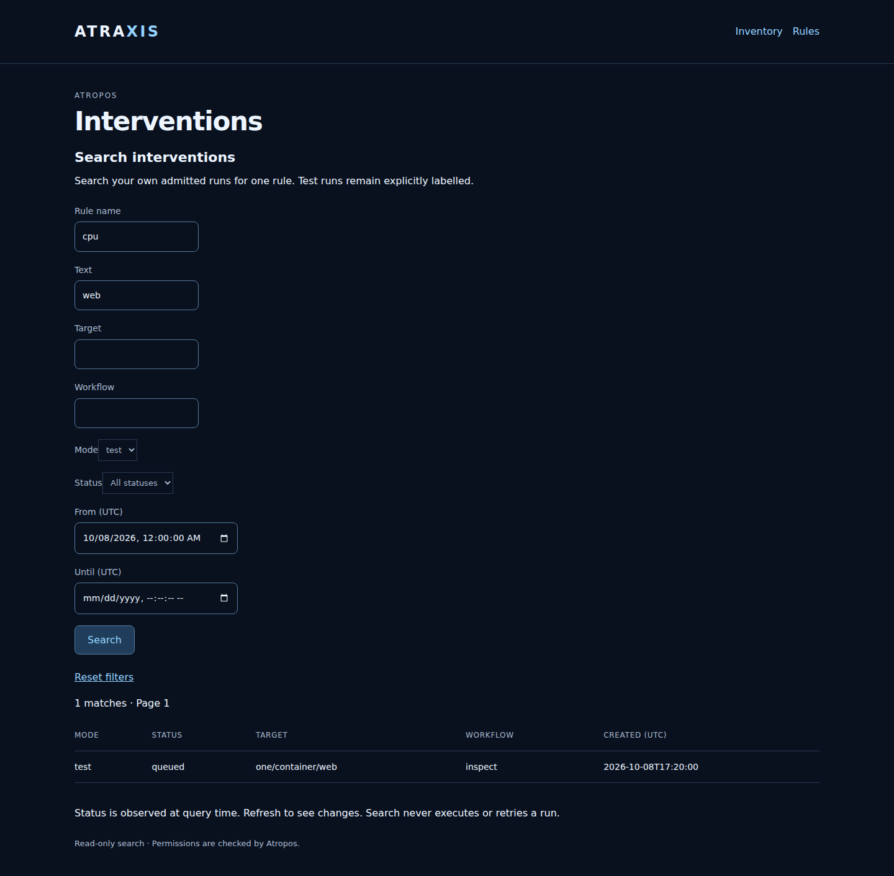
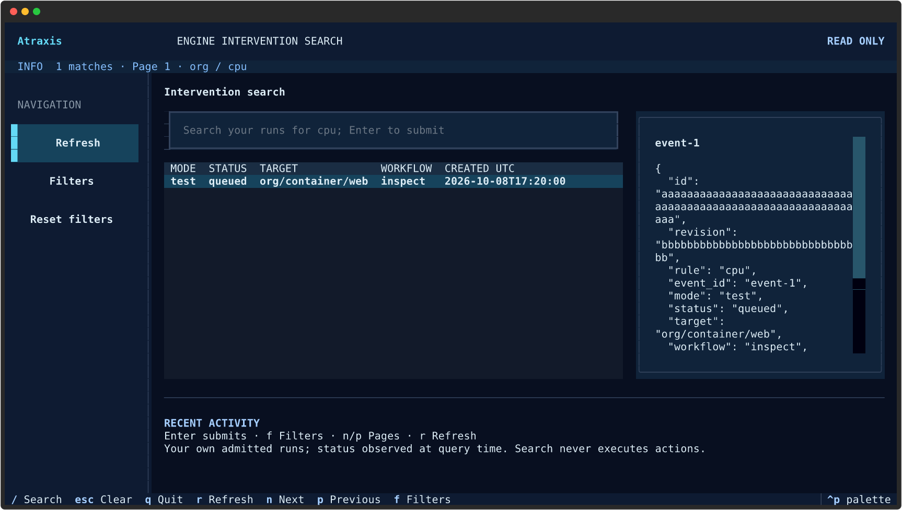

# Review and dispatch an approved workflow

Atraxis forwards explicit workflow requests to Atropos. Atropos owns the approved
binding, active rule version, scoped execution permissions, durable queue and
worker. No engine or rule storage is added to Atraxis.

Install the current `atropos-client` 0.1.0a9 and configure your normal
[remote profile](rule-remote.md). An administrator supplies an approved binding ID.
First preview its workflow and fixed parameters with manual evaluation facts:

```sh
atraxis rules --remote-config /private/remote.yml dispatch-plan cpu \
  --target container:web-example --input facts.json --binding BINDING_SHA256
```

Review the displayed workflow, target, parameters and active generation. This
command has no effects. Then submit explicitly using that exact generation and
a stable event ID:

```sh
atraxis rules --remote-config /private/remote.yml dispatch cpu \
  --target container:web-example --input facts.json --binding BINDING_SHA256 \
  --expected-generation ACTIVE_GENERATION --event-id incident-001 --confirm
atraxis rules --remote-config /private/remote.yml dispatch-status cpu \
  --event-id incident-001
```

Queued does not mean completed. A changed generation, wrong decision or missing
execution permission prevents admission. Before every step/retry, Atropos checks
its current identity mapping, permissions, binding, active generation and the
binding's maximum admission age. Refusal cancels future steps, without undoing
previous effects. Status includes the run's history; current read access is required.

After a lost response, query status using the **same event ID** before doing
anything else. The engine preserves deduplication evidence; no layer retries a
mutation automatically. Do not choose a new ID just to repeat an uncertain call.

Configured guarded workers can execute approved Auton actions and submit alerts.
Manual facts are not verified live telemetry and cannot set workflow parameters.
`observe`, `evaluate` and activation never dispatch automatically. The TUI has
no dispatch controls yet. Background automatic observation dispatch,
server-side approval administration and distributed revocation remain future work.
Revoking a frontend Atraxis token alone does not cancel work already accepted
by Atropos; revoke its engine identity or execution permissions for future steps.

See the [Atropos dispatch guide](https://github.com/decryptus/atropos/blob/main/docs/user/rule-dispatch.md)
for approval files, the guarded worker, admission age, uncertainty and migration.

For confirmed dispatch using verified current measurements and administrator tests through simulated alerts, see [observations and tests](observations-and-tests.md).

## Search your interventions

Open **Interventions** from the rule explorer, then enter a rule name. Search
covers your own admitted runs in the authenticated organization, with current
Atropos read rights on the current draft and each admitted revision, plus test
rights for test runs. It does not
expose other operators' runs or replace an administrator oversight interface.

Combine literal case-insensitive text with target/workflow substrings, mode
(`all`, `real`, `test`), status and an inclusive creation period in **UTC**.
The table distinguishes test and real runs; uncertain outcomes remain uncertain.
Results are counted before pagination, sorted newest first, and reflect the
status observed at query time. Refresh to see changes.

```sh
atraxis rules --remote-config rules-client.yml search-interventions high-cpu -q web --mode test
atraxis rules --remote-config rules-client.yml search-interventions high-cpu --status queued --since 2026-10-08T00:00:00 --until 2026-10-08T23:59:59
atraxis rules --remote-config rules-client.yml search-interventions high-cpu --tui
```

CLI output is JSON; `--page` and `--limit` control pagination (default 50,
maximum 200 rows). In Textual, `/` focuses search, Enter submits, `f` opens
filters, `n`/`p` change pages, Escape clears text and **Reset filters** clears
all filters. No filtering is restricted to loaded rows. Search is read-only:
it never admits, executes or retries an intervention.

Install matching Atropos client 0.1.0a9 and engine 0.1.0a19. Atraxis
forwards queries and stores no intervention history. The engine searches a
complete retained rule admission history up to 10000 lifecycle events; exceeding
that limit, or missing authorized run evidence, makes search unavailable without
partial results. Other rules require a new query; cross-rule search is not yet
implemented. New admissions and status changes can move pages between requests.
Text filters allow 128 printable characters; dates use UTC
`YYYY-MM-DDTHH:MM:SS` (optional trailing `Z` in CLI/Textual).

## Inspect an intervention

Select an event in the search table to open its read-only detail page. The page
shows the rule revision, run and event identifiers, target, workflow, current
status and execution history. Organization context follows the link. Access is
limited to your own runs and is checked again before details are displayed.
Test runs require test rights and are explicitly labelled **Test simulation**.

A history row reports the workflow status after an event. For example, `queued`
after a step can mean that another step is waiting; it does not prove that the
whole intervention completed. A newly admitted run can have no execution history.
Alert receiver acceptance does not prove delivery to a downstream recipient.
Raw action output and remote error bodies are not displayed.

An **uncertain** result means an external effect may already have occurred.
Reconcile that effect before submitting any new intervention. Opening or
refreshing this page never executes, retries or reconciles a run. A separate
reconciliation review is available when browser writes are configured and Atropos
grants the dedicated permission. Real admission has a separate optional
review and confirmation described below. An unavailable engine
or revoked access replaces the details with an error; it does not display cached
results. Search and detail reads are observations at different instants, not a
single atomic snapshot.

## Launch a test simulation in the browser

With `rules_web_origin` configured, open **Rules → Launch a test simulation**.
Choose a rule and target, then an approved test workflow and a JSON object of
manual facts. Only workflows with registered simulators and current scoped test
permission are offered. Their definitions, fixed inputs and test destinations
remain controlled by the engine; this form cannot change them.

**Review simulation** shows the exact revision, binding, actions, target, facts
and a new event identifier. It does not queue work. Keep that identifier, then
explicitly confirm to request a marked test. If the decision does not match the
binding, no run is admitted. Otherwise the browser opens the test detail page;
queued does not mean completed. A separately running test worker executes the
registered simulators. A configured test alert receiver may be contacted; its
acknowledgement does not prove downstream delivery. Real Auton jobs are not run.

Confirmations expire after 15 minutes and can be used only once, by the same
account and organization. Current permissions and binding availability are
checked again. Refreshing or replaying a confirmation never automatically
retries submission. If a response is lost or uncertain, search the **Test** mode
for the event identifier before considering any new submission. Manual facts
are not trusted observations, and this operation neither activates a rule nor
admits a real intervention. With browser writes disabled, these forms and routes
are unavailable.





## Confirm a real intervention in the browser

This optional control requires `rules_web_observations` in addition to
`rules_web_origin` and `inventory_access_file`; see [web configuration](web-rules.md#enable-observation-based-real-interventions).
Without that profile, the real-admission routes and link are absent.

Open **Rules → Review a real intervention**. Enter the rule name, container target
ID and the immutable observation-required binding ID supplied by your administrator.
The first submission collects currently valid measurements and shows the exact
active revision/generation, binding, workflow revision, approved steps, source,
facts and a new event identifier. It does not queue work. Fixed action parameters
remain defined by the approved binding and are not displayed or editable here.

After reviewing, check **I authorize this real intervention** and choose
**Confirm real intervention**. Confirmation collects observations again and checks
current inventory and engine rights. Changed measurements can refuse admission;
a changed active generation or observation profile requires a new review.
The form cannot supply manual facts, execution parameters, a destination or an
alternative identity. Only current monit-docker container observations are supported.

Keep the displayed event identifier before confirming. A successful response opens
the intervention details; queued means admitted, not executed. The separately
running guarded worker rechecks its current execution authority. Real Auton effects
and approved notifications may follow. A missing response remains unconfirmed:
search the **Real** mode for the same event before considering another submission.
The confirmation is single-use, expires after 15 minutes and never retries an
uncertain admission. Freshness budgets are checked separately; form lifetime does
not extend observation lifetime. Admission never automatically reconciles or retries.

## Reconcile an uncertain outcome in the browser

Open an uncertain intervention's details and choose **Review reconciliation**.
The form is available with the existing explicit `rules_web_origin` configuration;
it needs no observation-signing profile because it does not admit executable work.
Atropos must grant the admitting subject current revision read access and the
separate `reconcile` permission for the target and every stored workflow action.
Test-mode reconciliation additionally requires current test rights. Existing
execute rights alone do not authorize this operation. Use client 0.1.0a10 and
engine 0.1.0a20 together.

Independently verify the external outcome first. Choose succeeded or failed and
enter a concise verification reference or note (at most 2048 UTF-8 bytes, no
control characters, leading/trailing whitespace, secrets or credentials). Review
the target, run, mode, outcome and note, then explicitly confirm. The actor-bound
confirmation is single-use and expires after 15 minutes. Atropos compares the
complete stored state with the reviewed digest and checks current rights, worker
lease and target ownership before atomically storing the attestation and audit.

Confirmation closes the **whole run** and releases its target lock. It never
replays an action, starts remaining steps or invents missing action results.
The details and audit label the result **Operator-confirmed outcome**; this does
not prove that every step ran. Original history and diagnostics remain visible.
Test markers and stores remain separate from real interventions.

A missing confirmation response stays unconfirmed. Follow the detail link and
check the original run and audit before any new confirmation or intervention.
Neither refresh nor the client automatically retries the mutation.
