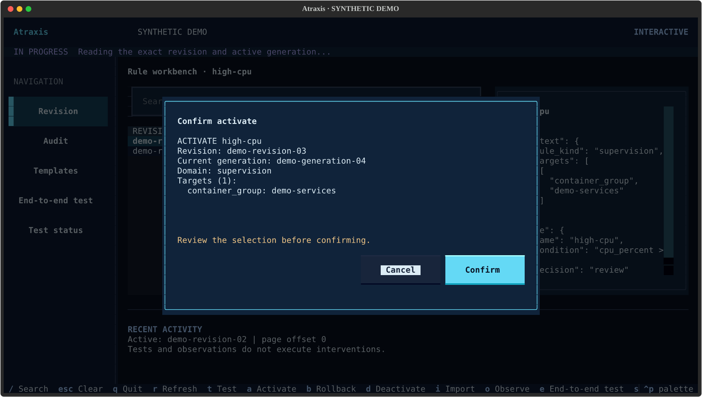
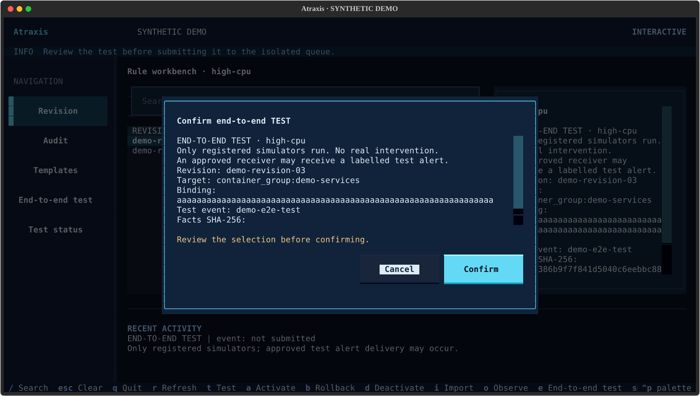
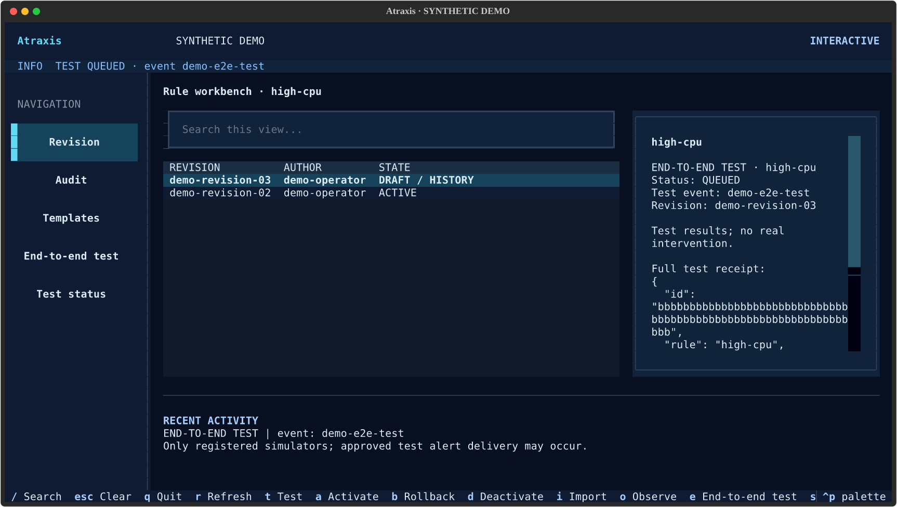
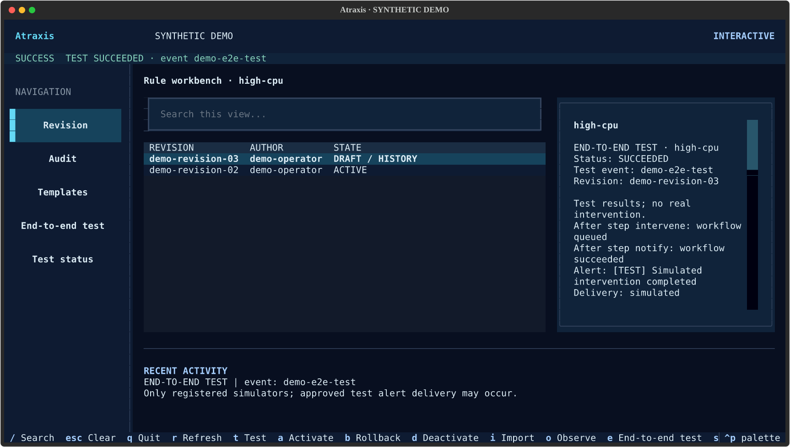
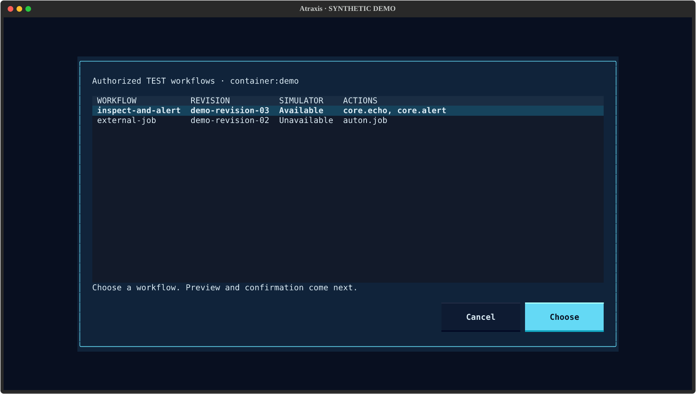

# Textual terminal interface

The Textual interface uses a midnight blue and cyan palette with DWho 0.3.66 or newer.
Navigation, tables and dialogs share the product colors. Labeled status colors
remain consistent across products: blue acceptance, violet in progress, green
success, amber warning or uncertainty, and red failure.

Install the optional extra with `pip install "atraxis[textual]"`.

Run `atraxis rules --operator-config operator.yml tui --ui textual --name RULE --cases cases.json`
or use `--remote-config` for the authenticated API client.

Select a revision, test it with t, then use a (activate), b (rollback) or d
(deactivate). A confirmation names the exact revision and active generation.
A conflict or uncertain response never triggers a retry. i imports a YAML/JSON
draft; o evaluates a fresh observation without executing an intervention.
Use the sidebar for revision details, audit and templates, and PageUp/PageDown
for history. Rule authority and persistence remain in Atropos.

Use / to search, Escape to cancel dialogs and q to quit. Requests run off the
UI thread; wait for pending requests before closing. The curses interface remains
available with `--ui curses`. Synthetic demonstrations are not production evidence.

## Synthetic interface examples

The same workbench supports an explicit environment-configured connection:
`atraxis rules --remote tui --name cpu --ui textual`. See
[remote connection settings](rule-remote.md#environment-configuration-for-cli-and-textual)
for variables, precedence and token-file handling.

## End-to-end administrator tests

Press **e** to enter a concrete target (`container:web`, for example). Choose
an authorized workflow from the list, then supply a synthetic facts JSON file
and a stable test event ID. The engine
previews the decision first. A nonmatching decision cannot be submitted from
this screen. Review the exact rule revision, target, binding and facts digest;
then confirm to queue the test. Cancelling submits nothing. The facts file is
read once: editing it after the preview does not change the confirmed request.

Only registered simulators run. If the administrator configured a dedicated
test alert receiver, it may receive a labelled test notification. This does not
execute a real intervention, activate a rule or produce activation evidence.
The engine checks current permissions; a user needs the appropriate test scopes.

Press **s** to read test status using the same rule, account and event ID. The
last event is prefilled during the session. Keep that ID to recover status after
closing the console or losing a response. Requests are not automatically retried
or polled. An unconfirmed submission must be checked with **s**, not resubmitted.
Queued is informational, running is in progress, succeeded is confirmed test
completion, failed/cancelled are failures and uncertain is a warning. An alert
receiver acknowledgement does not prove delivery beyond that receiver.

This test-run screen uses an approved binding's revision, which may differ from
the selected history row. The **t** key remains the separate exact-revision
scenario test used before activation. Bindings and simulators are configured by
the engine administrator; this interface does not create them.

## Authorized workflow selection

The list comes from Atropos for your current rule, target and authenticated
account. A workflow appears only with read/test access to its rule revision and
test rights for every action on that target. Container-group grants may authorize
member containers; they do not grant access to the server. Enter a concrete
`server:ID` or `container:ID` target, not a group selector.

Each row shows the workflow name, abbreviated revision, action names and whether
all its simulators are available. Unsupported rows remain visible but cannot be
selected. No accessible rows means there is no selectable workflow for this
scope; the interface does not fall back to a broader list or a real intervention.
Cancel or Escape closes the selector without previewing or submitting anything.

Listing is read-only and does not reserve permission. The engine rechecks scope
on submission and during execution. A workflow removed or access revoked after
selection is refused; refresh the selection instead of retrying blindly. The
list contains metadata only, without configured workflow inputs or credentials.
It is bounded to the engine's maximum of 64 approved bindings.

CLI equivalent: `atraxis rules --remote test-bindings cpu --target container:web`.
Manual binding IDs remain available in CLI commands. Install the matching
client **0.1.0a5** and engine **0.1.0a10** for discovery; older engines do not
support this command. No client-side fallback is attempted.

## Test queue capacity

When the engine explicitly refuses a new test because its isolated queue is full,
Textual displays a warning that the test was **not admitted**. It does not show
success, retry automatically or remove existing tests. An ambiguous response
still requires status recovery with the stable event ID. Capacity is administered
on the Atropos host; Atraxis does not own the engine's queue configuration.

## Inventory read-grant administration

The local [inventory access editor](inventory-administration.md#local-textual-editor)
provides scoped listing, add/remove forms, explicit review and recent changes.
It uses the same authorization, revision checks and atomic audit as the web editor.
Run `atraxis inventory-admin --config /path/to/inventory-access.yml tui`.

## Inventory search

See the [inventory search guide](inventory-search.md) for authorized search before
pagination, combined filters, the CLI and Textual interfaces.
