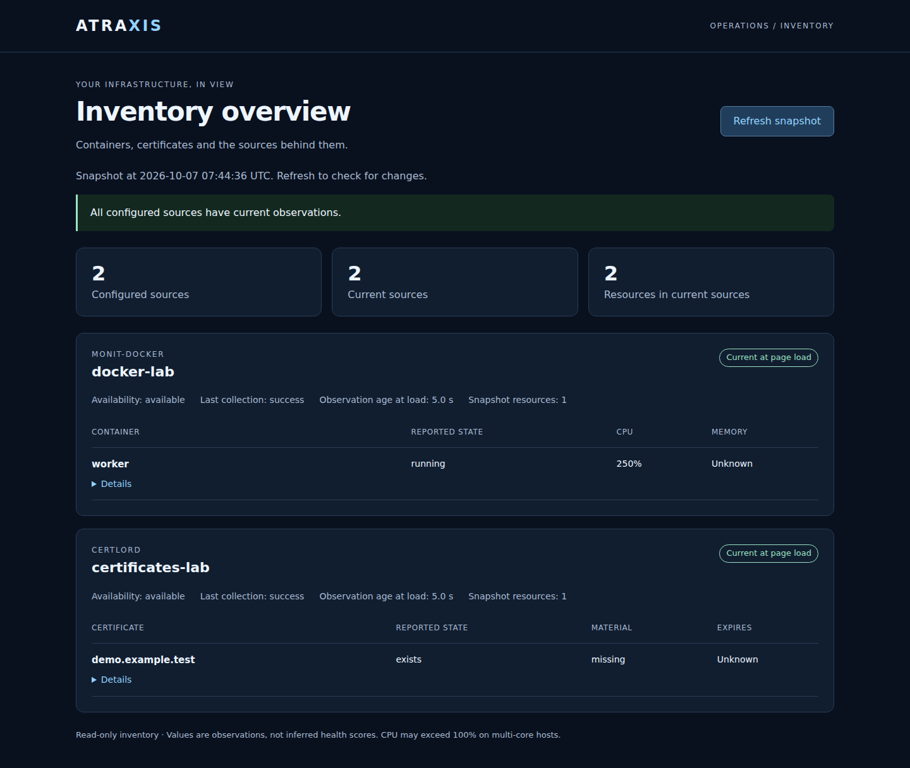
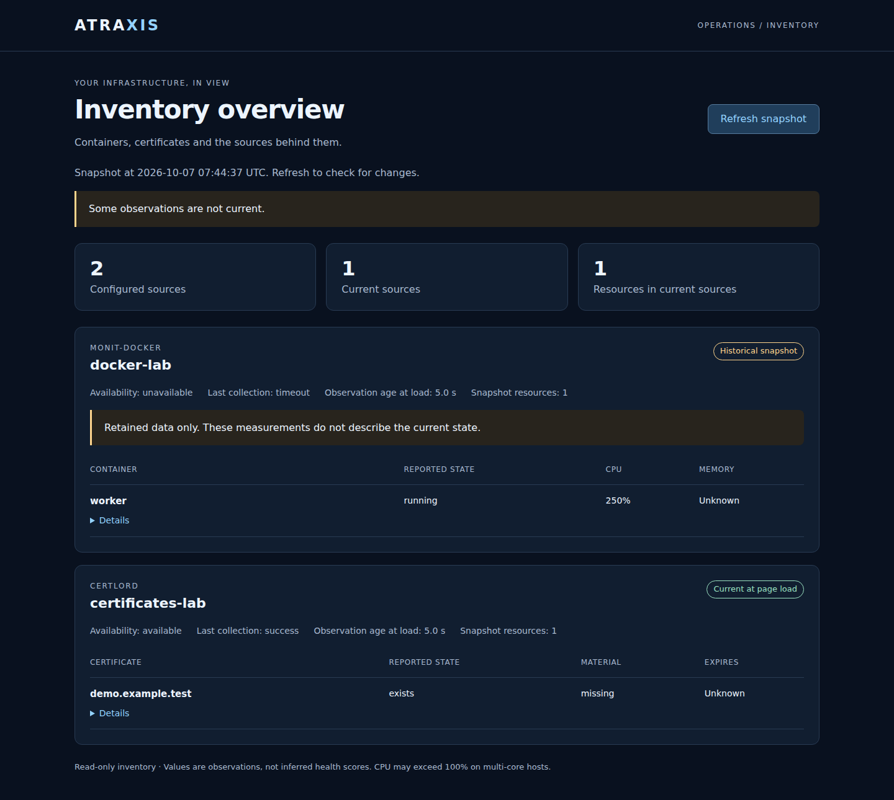
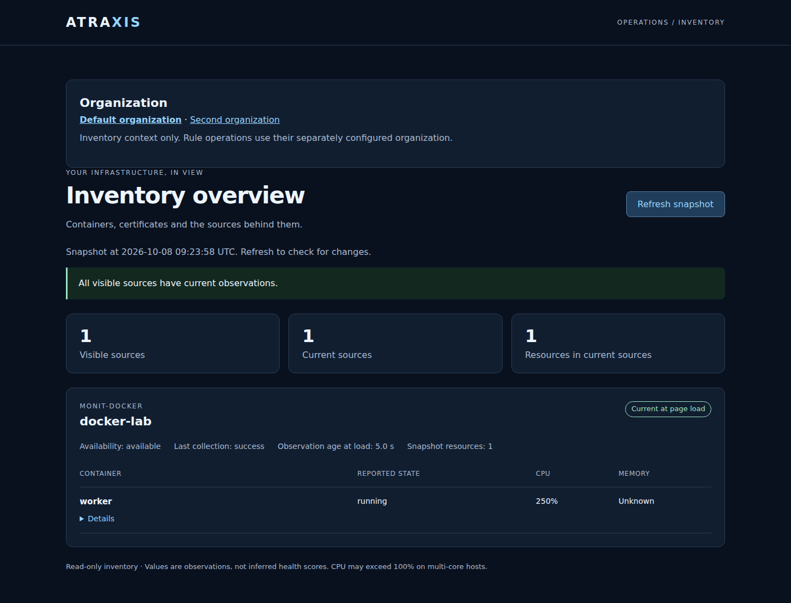
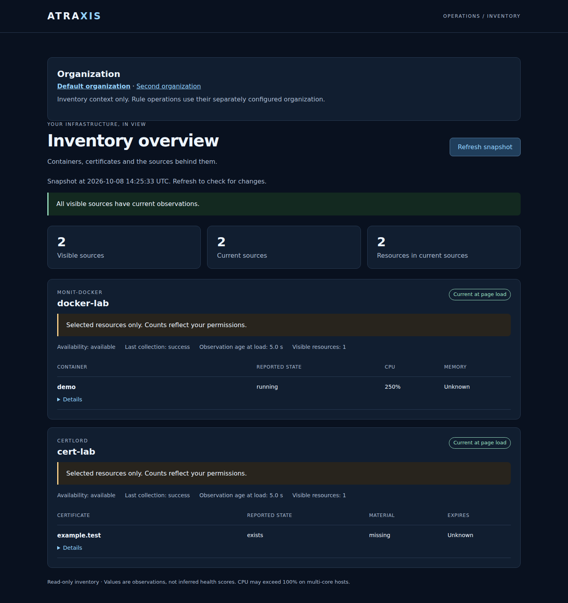

# Web inventory

Start the configured daemon with `atraxis serve --config /etc/atraxis/atraxis.yml`,
then open `/ui` on its address, for example `http://127.0.0.1:9810/ui` locally.
The browser asks for the same HTTP Basic credentials as the inventory API.
For remote access, use the verified HTTPS reverse proxy described in the
[runtime guide](../docs-runtime.md). Do not send credentials over remote HTTP.

The page shows configured monit-docker and CertLord sources, collection state,
containers, certificates and available measurements. Open **Details** for resource
identity and additional observations. **Refresh snapshot** reloads the page;
there is no automatic refresh. The UTC timestamp and observation ages describe
the moment the page was loaded, not a continuous live view.

- **Current at page load:** the source had a current valid observation.
- **Historical snapshot:** retained measurements are displayed after a failure,
  expiration or collector stop; they do not describe the current state.
- **No observation:** there is no valid snapshot. Resource count and metrics are
  unknown. Unknown values are never replaced with zero.

The resource total counts only resources in current sources. It is not a global
inventory total when some sources are unavailable. Source readiness does not
mean every container is healthy or every certificate is usable. Reported state,
certificate material and measurements remain separate; Docker CPU can exceed
100% on multi-core hosts.

Each source displays at most 200 rows, with an explicit notice if more exist.
Use [the inventory CLI](cli.md) or `/v1/status` for the complete snapshot within
the configured collection limits. On narrow screens, resource tables scroll
horizontally. Details and refresh are keyboard accessible.

## Access and scope

Without `general.inventory_access_file`, authenticated accounts share the daemon's
configured inventory. Enable the private access profile below for organization-
and user/group-scoped reads on **both `/ui` and `/v1/status`**, including HEAD.
`/readyz` reports only the selected scope; `/healthz` returns process liveness only.

```yaml
# In the daemon configuration
general:
  auth_basic_file: users
  inventory_access_file: inventory-access.yml
```

The private profile maps authenticated usernames to existing account subjects and
explicit read grants. Paths are relative to the profile file. Protect the profile
with mode 0600 and the account directory as described in [Accounts](accounts.md).

```yaml
version: 3
administrators: []
audit: []
store:
  backend: sqlite
  url: sqlite:///private-accounts/directory.sqlite3
identities:
  - username: alice-login
    subject: alice
servers:
  - id: production-01
    organization: operations
    sources: [docker-production]
resource_groups:
  - id: web-containers
    organization: operations
    targets:
      - kind: container
        source: docker-production
        id: aaaaaaaaaaaaaaaaaaaaaaaaaaaaaaaaaaaaaaaaaaaaaaaaaaaaaaaaaaaaaaaa
grants:
  - organization: operations
    subject_kind: group
    subject: operators
    targets:
      - kind: group
        id: web-containers
  - organization: staging
    subject_kind: user
    subject: alice
    targets:
      - kind: source
        id: docker-staging
```

Organization membership is required, but does not itself grant inventory access.
Group grants use current effective membership, including explicit downward
inheritance and disabled ancestors. Account administrators gain no implicit read
access. Grants are configured locally or through the explicitly enabled
[read-grant editor](inventory-administration.md); they are separate from Atropos
rule/action permissions and account-administration delegations.

With multiple memberships, `/ui` asks you to select an organization. Only your
current organizations are listed. One membership is selected automatically.
Selection is explicit in the URL, for example `/ui?organization=operations`, and
**Refresh snapshot** preserves it. Different tabs can use different organizations;
there is no shared cookie or silent organization change. An inaccessible requested
organization is denied rather than replaced by another one.

API clients use `/v1/status?organization=operations` and
`/readyz?organization=operations`. Multiple memberships without selection return
409 `organization_required` with the caller's available contexts. No visible
sources yields an empty scoped inventory and readiness 503, not a healthy empty
fleet. Unmapped/revoked accounts get 403; unavailable private access configuration
or account storage gives 503. There is no fallback to the shared inventory when an
enabled profile fails. Changes are checked on every request and again after
reading the snapshot. Already delivered pages do not disappear remotely: refresh
to observe revocation. A filesystem change after the final check remains a race.

### Servers, resources and resource groups

Each grant's `targets` list accepts these exact selectors:

| Kind | Fields | Read access |
| --- | --- | --- |
| `source` | `id` | Every resource and metadata in that source |
| `server` | `id` | All sources explicitly attached to that server in this organization |
| `container` | `source`, `id` | One container, using its full lowercase 64-character Docker ID |
| `certificate` | `source`, `id` | One certificate, using its canonical lowercase UUID |
| `group` | `id` | Targets from the named resource group in this organization |

Server entries are **operator-maintained source associations**, not discovered host
identities or new host telemetry. Attach only feeds belonging to that server. A
source cannot belong to multiple server entries. Once attached, all selectors for
that source must use its server's organization. A grant on a server covers every
present and future resource in its attached feeds. It grants no right to execute
an action or change source configuration.

Resource groups are separate from account groups. `subject_kind: group` identifies
an account group whose members receive a grant; a target with `kind: group`
identifies a collection of resources. A resource group may contain containers,
certificates, sources and servers, allowing groups of servers or containers. Group
references are organization-local. Nested resource groups are deliberately rejected.
Use `servers: []` and `resource_groups: []` if neither catalog is needed.

Read grants add together. A whole-source or server grant supersedes narrower
selectors on the same source, including access to source-wide metadata. Group
membership, server associations, group targets and grants are reread on every
request. Catalog and administrator-scope edits require trusted local configuration.
The optional inventory read-grant editor can add/remove grants within its explicitly
configured administration bounds; the account editor does not assign these rights.

Exact resource matching uses **source + kind + native ID**. Names, ID prefixes,
wildcards and automatic following of replacement containers are unsupported.
Replace a recreated container's ID explicitly after review. Resource grants expose
that resource's reported fields, not selected individual metrics. They also expose
the source ID and collection availability/timing needed to interpret observations.

For a partial source view, both latest-attempt and historical-snapshot aggregate
metadata are removed. Only matching resource rows and their visible counts remain.
The page and CLI mark the view **Selected resources only**. No hidden totals or
resource-group catalogs are returned. Historical rows are filtered using current
permissions, just like current observations. A current snapshot with no matching
rows means **no selected resources are present**, not that the whole source is
empty. Readiness still measures collection freshness, not existence or health of a
selected container; a missing selected ID can coexist with readiness 200.

This profile uses **version 3**, including `administrators` and `audit` lists.
Earlier versions are rejected. To retain a version-2 configuration, preserve a copy,
set `version: 3` and add `administrators: []` and `audit: []`. This does not enable
web editing. Version-1 grants also need conversion from `sources` to
`targets: [{kind: source, id: SOURCE_ID}]` and both catalogs. No account data is
changed or deleted automatically.

The local collector still maintains its full configured snapshot; API-backed CLI
reads use the same HTTP gate and preserve the partial-view marker. This is not
OS-user isolation. The current CLI selects a sole membership automatically;
multiple memberships require the browser or an API request with an explicit
organization until CLI selection is added.

The browser manages HTTP Basic credentials; this screen has no application logout.
Close the browser session to clear cached credentials. The inventory selector does
not change the separately configured organization for rule operations or account
administration.

The optional [web rule explorer](web-rules.md) adds rule revision reads through
Atropos with per-account mappings. Simulations, interventions and alerts remain
accessible through their existing CLI/Textual interfaces. The full scoped web
interface remains required for the community 1.0 release.

The page loads no external assets, scripts or fonts, stores no browser data and
offers no mutation operation. It uses the existing collector snapshot; opening
or refreshing it does not trigger additional upstream polling.

## Interface examples

These captures use synthetic sources and observations.





[Mobile view](images/web-inventory-mobile.png)



[Organization selector on mobile](images/inventory-context-mobile.png)



[Partial resource view on mobile](images/inventory-resources-mobile.png)

## Inventory search

See the [inventory search guide](inventory-search.md) for authorized search before
pagination, combined filters, the CLI and Textual interfaces.
