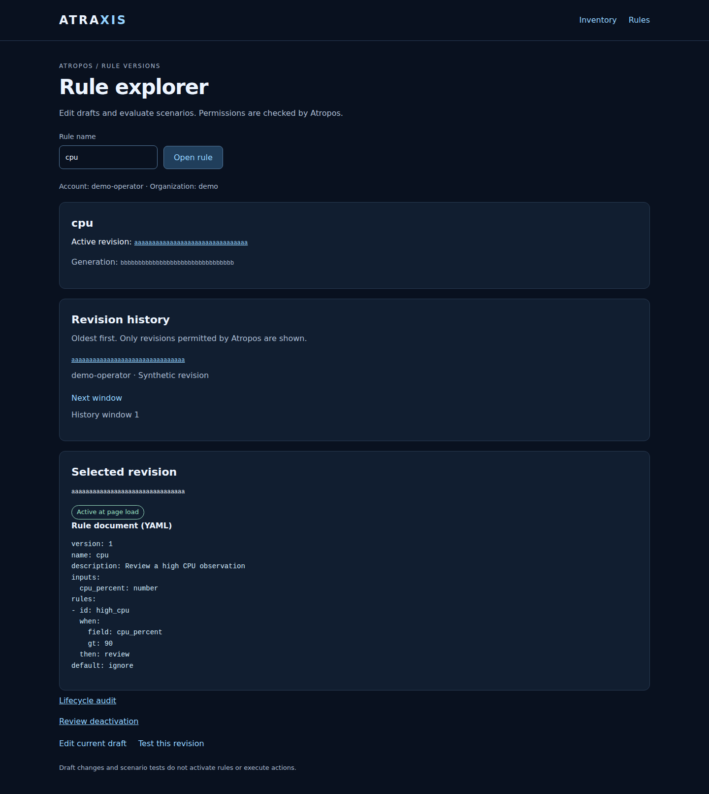
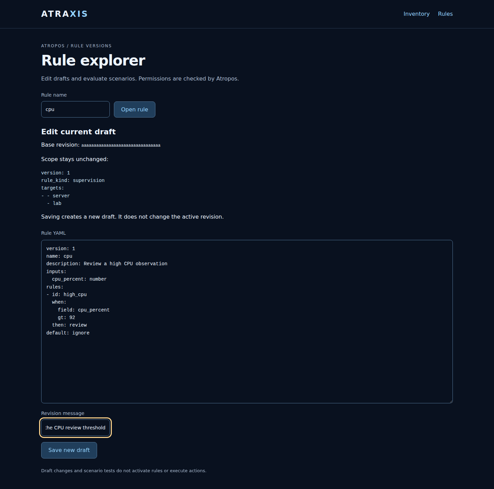
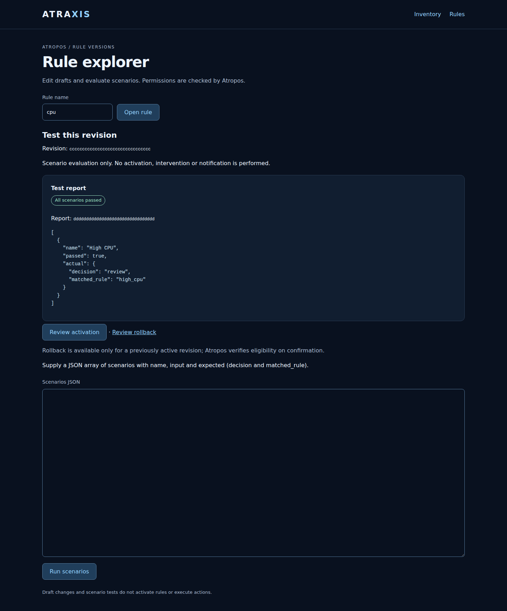
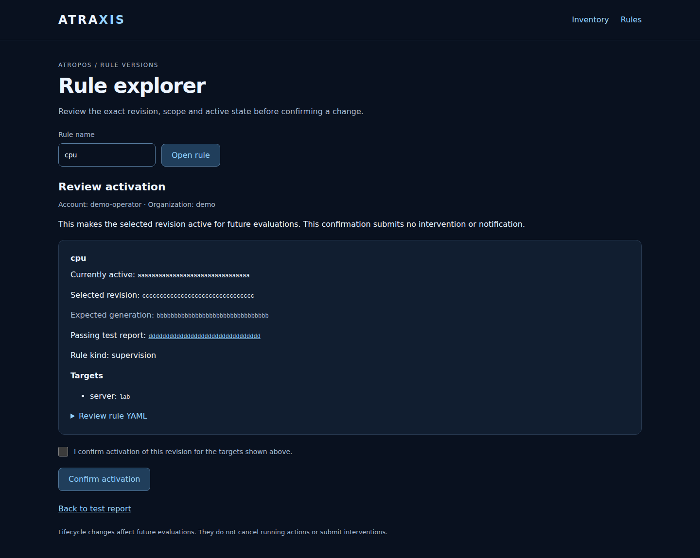
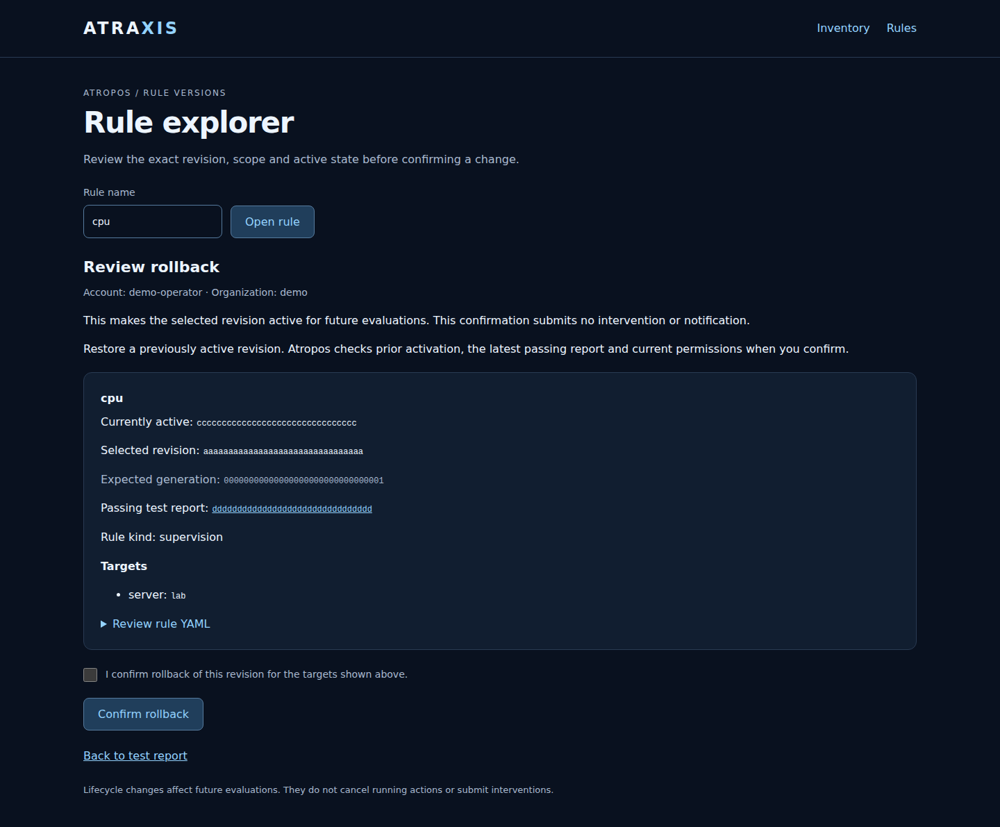
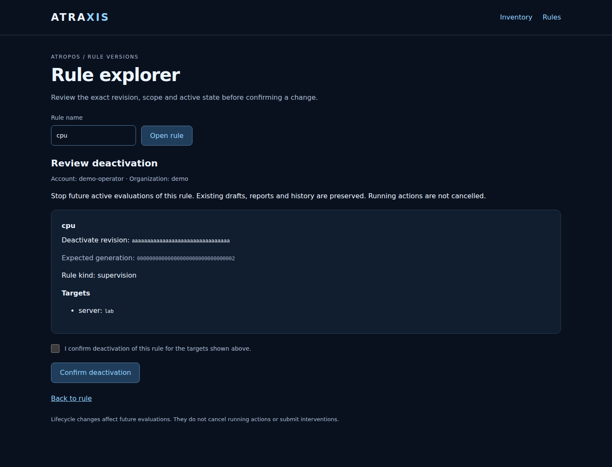
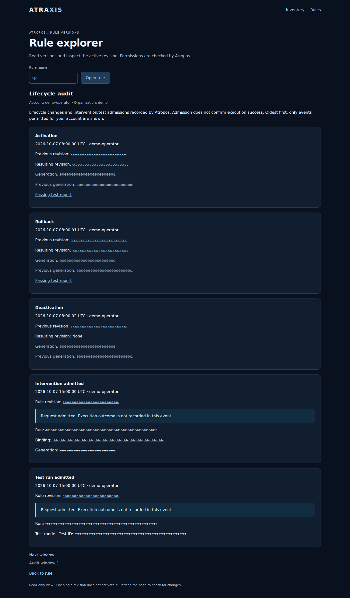

# Web rule explorer

The optional **Rules** screen opens `/ui/rules` on the inventory daemon. It reads
rule history, the active revision and a selected revision's YAML document from
Atropos. By default it is read-only. An explicitly configured browser origin enables
creating/importing new drafts, editing existing drafts, running revision-bound scenarios and reviewing lifecycle changes,
as described below.
Saving and testing never activate a rule. A separate explicit review/confirmation
can activate a tested revision; it submits no intervention or notification.

## Connect accounts to Atropos

Install Atraxis with its `rules` extra and the matching independent private
Atropos client. Use an [Atropos connection profile](rule-remote.md) for each engine
identity. That profile contains the engine address and a private token-file
reference; it is never sent to the browser. Atropos must associate the token
with the exact subject and organization declared below.

Add the optional mapping file to the daemon configuration:

```yaml
general:
  auth_basic_file: users.htpasswd
  rules_web_file: web-rules.yml
```

`web-rules.yml` maps verified HTTP Basic usernames to engine identities:

```yaml
version: 1
identities:
  - username: alice
    subject: alice
    organization: demo
    atropos_client: engine-alice.yml
```

The mapping file must be a regular, owner/root-owned private file (mode `0600`),
not a symlink. Paths in daemon configuration are relative to its file; each
`atropos_client` path is relative to the mapping file. The engine profiles and
token files retain the independent client's private-file and TLS requirements.
The web mapping contains no grants: configure read rights in Atropos itself.

Validate with `atraxis check-config --config /etc/atraxis/atraxis.yml`, then
restart the daemon to enable the route. Open `/ui` and choose **Rules**. Without
`rules_web_file`, the route is absent and the basic inventory installation needs
no rule client. Use HTTPS for remote browser access.

## Browse a rule

Enter the rule's exact name, such as `high-cpu`. The page displays its active
revision and a history window. Select a revision to view its normalized YAML.
The selected revision is explicitly distinguished from the active revision.
Reading either never activates a rule.

History is oldest first, in windows of 20 entries, with inaccessible revisions
removed by Atropos. **Next window** remains available on an empty filtered window
because later windows may contain accessible revisions. This initial explorer
opens known rule names; it does not discover or list every rule in the engine.
Refresh the page to obtain a new view of revisions and active state.

## Access and errors

Every request requires daemon authentication and a matching username mapping.
Every engine call sends the configured expected subject/organization and uses
the mapped profile; the engine enforces its current scopes. URL parameters cannot
select another identity, organization, client profile or action.

The mapping is reloaded before and after each engine call. Removing an identity,
or changing its mapping during a request, discards the response and denies access.
An empty `identities: []` file revokes all web rule mappings. Previously rendered
pages cannot be withdrawn from a browser, but responses are marked `no-store`.
Password-file changes follow the daemon authentication lifecycle; this feature
does not add application login/logout sessions.

An unmapped or unauthorized account gets **Rule access denied**. Missing rules
or revisions and service failures produce fixed errors, without backend response
bodies, tokens or connection paths. A failed request displays no partial rule
history. The page does not automatically retry.

This mapping scopes rule access only. Inventory visibility and account administration
use their separate access profiles; rule permission never grants either authority.
Changing an existing rule's scope and intervention/alert controls are not part of
these draft forms.

## Interface example

This capture uses a synthetic account and a rule conforming to the Atropos schema.



[Mobile view](images/web-rules-mobile.png)

## Enable draft editing and scenario tests

Set the exact public browser origin in the daemon configuration:

```yaml
general:
  auth_basic_file: users.htpasswd
  rules_web_file: web-rules.yml
  rules_web_origin: https://console.example.test
```

An origin is the scheme, hostname and optional port, with no trailing slash or
path. Use HTTPS; HTTP is accepted only for an explicit loopback IP address.
The configured origin is not inferred from request or proxy headers. Your proxy
must preserve the browser's `Origin` header. Restart the daemon after changing
configuration. Without `rules_web_origin`, creation, import, editing, test, activation, rollback and
deactivation routes are absent. Read-only rule history and lifecycle audit remain available.

### Create or import a new draft

From **Rules**, choose **Create from template**. Enter a new rule name, rule kind,
target kind and target ID, then select a template from the engine's current
catalogue. **Create draft** stores one immutable draft in Atropos. The selected
catalogue version is pinned to the form. Template defaults are examples: review
the resulting YAML and thresholds before testing or activation.

Alternatively choose **Import a new rule**, enter the same scope fields and paste
the rule YAML. Its `name` must match **New rule name**. Atropos validates its grammar
and requires current `import` permission for the upload provider as well as
`create` and internal-provider `save` rights for the selected scope. Template
creation requires `create` and internal-provider `save` rights.

These forms select one concrete server or container; they do not overwrite an existing rule or change
an existing scope. If the name is already used, open its current draft to edit it.
Creating/importing does not activate the rule, execute an intervention or send a
notification. Continue with **Test this revision**, then the separate activation
review if appropriate. Forms retain the same single-use, expiry, current mapping
and unknown-outcome protections described below. Keep a local copy of imported
text before submitting: errors do not retain unsaved content.

Open a known rule and choose **Edit current draft**. The editor loads the current
draft from Atropos, displays its base revision and existing scope, and lets you
change its YAML and revision message. The name, rule kind and targets stay fixed.
**Save new draft** creates a new immutable revision in Atropos. The active revision
is unchanged. If somebody saved another revision in the meantime, the save is
refused: reopen the latest draft and reconcile your edits. Invalid forms and errors
do not retain unsaved text; keep a local copy before submitting substantial edits.
Atropos checks current `read`, `update` and internal-provider `save` permissions.
This editor does not add engine rule validation or storage to Atraxis.

Select a saved revision and choose **Test this revision**. Supply a JSON array:

```json
[
  {
    "name": "High CPU",
    "input": {"cpu_percent": 95},
    "expected": {"decision": "review", "matched_rule": "high_cpu"}
  }
]
```

Adapt inputs and expected decisions to your rule. Atropos checks `test` permission,
evaluates the exact displayed revision and stores its test report. The page shows
passed/failed scenarios and actual results. Save the report URL to reopen it;
reading that URL checks current `read` permission and never reruns the scenarios.
These are **rule evaluation tests**, not queued end-to-end workflow simulations.
They do not activate a rule, invoke Auton or deliver an alert.

Forms expire after 15 minutes, are bound to the authenticated account and current
mapping, and can be used only once. Reopen a form after expiry, restart or a refused
submission. Opening many forms may invalidate older ones. The daemon keeps only
bounded, temporary form metadata in memory; authoritative documents and reports
remain in Atropos. Run this increment in one daemon process: independent replicas
do not share form tokens, so a request reaching another replica is refused.

The browser is redirected after a successful save/test. Refreshing the result page
never repeats the operation. If the outcome is unconfirmed, do not resubmit blindly:
check revision history or the report if you have its identifier. Otherwise ask an
engine administrator to inspect the operation. Revocation during an operation can
hide its result even if Atropos already accepted it. No automatic retries occur.

YAML input is limited to 128 KiB; scenarios to 64 KiB and 100 cases. The server
rejects duplicate form fields, YAML aliases/duplicate keys and non-finite JSON.
Atropos remains authoritative for grammar, scope and evaluation limits.

## Draft editor and scenario report

These captures use a synthetic account, rule and engine boundary.



[Mobile draft editor](images/web-editor-mobile.png)



[Mobile scenario report](images/web-test-report-mobile.png)

## Review and confirm activation

From a passing test report, choose **Review activation**. This opens a read-only
review showing your account and organization, the current active revision, the
revision to activate, the report, rule kind and all target resources. Expand
**Review rule YAML** to inspect the exact document. Opening the review, refreshing
it, or choosing **Back to test report** does not activate anything.

To apply the change, check the confirmation box and choose **Confirm activation**.
The request uses the exact revision, report and active generation displayed during
review. Atropos checks activation rights for both the currently active scope and
the selected scope, the latest passing report, content/scope hashes and compiler.
A browser review is not a grant of activation permission.

If another administrator changes the active version, confirmation is refused.
Reopen the review to inspect the new state. If the test evidence is no longer
current or valid, run scenarios again and review the new report. The form is
single-use and expires after 15 minutes, like the editor forms. Changing accounts
or mappings invalidates it. An already active revision has no confirmation form.

Success returns to the rule explorer, where the active revision can be checked.
Refreshing that page does not repeat activation. Atropos owns the atomic state
transition and audit record. If the result is uncertain, inspect the active state
and engine audit before trying again; Atraxis does not retry automatically.

**Activation changes which revision future evaluations use.** This confirmation
submits no job, intervention or notification; action admission remains separate.
Rollback and deactivation use separate confirmations, described below.

### Activation review example

Synthetic account and engine boundary; no production rule is activated by this capture.



[Mobile activation review](images/web-activation-mobile.png)


## Restore a previously active revision

Open the desired revision from **Revision history**, choose **Test this revision**
and run scenarios. From its passing report, choose **Review rollback**. The page
shows the currently active revision, the proposed revision, its scope and the test
report. Check the confirmation box, then choose **Confirm rollback**.

Atropos requires that the selected revision was active previously. It checks
current `rollback` and `activate` rights on both the previous and selected scopes,
the latest passing test evidence and the exact active generation. A never-active
revision must use the activation flow instead. Opening a rollback review does not
prove eligibility or reserve the current state: permission and evidence checks
remain authoritative at confirmation. If the selected revision is already active,
no confirmation form is shown.

Rollback changes the active revision; it does not rewrite the draft, remove later
versions or undo actions that already ran. Concurrent changes, stale reports,
expired forms and uncertain responses follow the same rules as activation.



[Mobile rollback review](images/web-rollback-mobile.png)

## Deactivate a rule

From the rule explorer, choose **Review deactivation**. Review the active revision
and its targets, check the confirmation box, then choose **Confirm deactivation**.
Atropos checks `deactivate` permission and compares the active generation from the
review. If the active state changed, reopen the review before trying again.

Deactivation stops future active evaluations. **It does not cancel running actions
or delete drafts, history or test reports.** A rule that is already inactive has no
confirmation form. After success, the explorer shows **Not active**. Refreshing
that result never repeats the request. If the outcome is unconfirmed, check the
active state and **Lifecycle audit** before submitting again.



[Mobile deactivation review](images/web-deactivation-mobile.png)

## Read the lifecycle audit

Choose **Lifecycle audit** from the rule explorer. Atropos supplies its recorded
activation, rollback and deactivation events, including the operator, UTC time,
previous/resulting revisions, previous/new generation and test evidence where
applicable. Draft saves and scenario runs are not lifecycle transitions and are
not included in this view. Intervention and marked test-run admissions are also
shown with their rule revision and run ID. Intervention records identify their
binding/generation; test records retain the test ID. Blue admission notices mean
accepted work, not confirmed execution or success. The audit is read-only;
revisiting it performs no action.

Events are oldest first in windows of 20. Atropos checks current read permission
for every scope involved in an event before returning it. An empty window does
not mean that the rule has never changed or that the audit has ended: later
windows may contain accessible events. **Previous window** and **Next window**
allow navigation. Removing a web mapping denies subsequent requests, including
requests already in progress when the removal is detected.



[Mobile lifecycle audit](images/web-audit-mobile.png)

## Archive, unarchive and delete

The rule page offers **Review archive**, **Review unarchive** and **Review delete**
when browser changes are enabled. Each review identifies the draft and current
status and requires a fresh, account-bound confirmation. Atropos checks the exact
head, availability generation and the relevant permission for every historical
scope. Conflicts or unknown outcomes never trigger an automatic retry.

Deactivate an active rule before archiving. Archive preserves contents and audit;
unarchive makes the rule available but never activates it. Permanent deletion is
limited to never-activated drafts without linked real or simulated interventions.
Contents and scenario reports are removed; scoped audit remains accessible and the
name stays reserved. Used rules must be archived. Administrative purge is not
implemented. After deletion the confirmation redirects to the retained audit.

In the Textual workbench use **Shift+A** (archive), **Shift+U** (unarchive) and
**Shift+D** (delete draft). Each opens a review and confirmation. The curses fallback
uses uppercase A/U/D. CLI users first inspect the availability generation:

```sh
atraxis rules --operator-config /private/operator.yml availability cpu
atraxis rules --operator-config /private/operator.yml archive cpu \
  --expected-revision REPLACE_WITH_DRAFT_REVISION \
  --expected-generation none --confirm
```

Use the generation returned by `availability` after the first retirement change;
it is separate from the active generation. `unarchive` and `delete` use the same
arguments. Install the matching independent Atropos client **0.1.0a7** and engine
**0.1.0a14**. Rule storage and all eligibility checks remain in Atropos.


## Explicit organization context

One authenticated username, OS UID or gateway token may have several mappings,
one per organization, all naming the same subject. Each mapping retains a separate
Atropos credential for exactly that subject and organization. Duplicate organization
mappings or different subjects under one identity are rejected. With multiple
eligible mappings, no organization is chosen implicitly.

The browser offers an organization selection page and carries the choice in links,
GET fields and confirmation URLs across inventory, rules and interventions. Tabs
are independent. A form is bound to the selected organization and cannot be reused
in another. An unavailable inventory scope is refused rather than replaced with
a global inventory view. Current membership and server mappings are rechecked.

For local or remote CLI and terminal commands, select before the subcommand:

```sh
atraxis rules --operator-config operator.yml --organization operations tui --name cpu --ui textual
atraxis rules --remote-config client.yml --organization operations history cpu
```

The matching client is **0.1.0a9**. Remote selection uses an explicit
`X-Atraxis-Organization` request header. The gateway resolves the acting subject
from the authenticated token and the destination from its own mapping; the header
is only a selection, never a permission or credential. Direct Atropos clients
remain bound to their engine credential. Switching terminal organization requires
a new command/session, so pending confirmations cannot change context silently.

## Enable observation-based real interventions

Real browser admission is a separate opt-in, disabled even when draft editing and
test simulations are enabled. Install the matching client with its
`observations` extra, configure current [inventory access](web-inventory.md), and
add the observation profile:

```yaml
general:
  auth_basic_file: users.htpasswd
  rules_web_file: web-rules.yml
  rules_web_origin: https://console.example.test
  inventory_access_file: inventory-access.yml
  rules_web_observations: web-observations.yml
```

`web-observations.yml` contains source mappings and a signing-key reference only:

```yaml
version: 1
bindings:
  - organization: demo
    target: [container, web]
    source_id: monit
    native_id: aaaaaaaaaaaaaaaaaaaaaaaaaaaaaaaaaaaaaaaaaaaaaaaaaaaaaaaaaaaaaaaa
observation_signing:
  key_id: collector
  private_key_file: observation.pem
```

Replace the example native ID with the actual 64-character container ID. For a
filesystem rule, add `filesystem: [GROUP, /exact/path]` to that binding. The
profile and Ed25519 private key must be regular private files, mode `0600`, owned
by the daemon user or root; symlinks are refused. The key path is relative to the
observation profile. Atropos must trust the corresponding public key and approve
an immutable observation-required workflow binding for this exact source/target.
See its [observation setup guide](https://github.com/decryptus/atropos/blob/main/docs/user/observations-and-tests.md).

The browser username must resolve to the same subject in its rule and inventory
profiles, with current organization membership and inventory read grants. Current
Atropos read/evaluate/execute permissions remain independently required. No OS
identity, collector-wide visibility or remote inventory credential is inherited.
Collection uses the daemon's current authorized inventory projection and rejects
missing, stale, ambiguous or wrong-source measurements. Identity, inventory grants
and observation profile are rechecked during each operation.

Restart after enabling the daemon option. A profile change invalidates an existing
review; open a new review. Opening the form never contacts an executor. Follow the
[real intervention review procedure](rule-dispatch.md#confirm-a-real-intervention-in-the-browser).

An uncertain intervention also has a separate
[reconciliation review](rule-dispatch.md#reconcile-an-uncertain-outcome-in-the-browser)
when browser writes are configured. The engine's dedicated `reconcile` permission
is required; execute rights do not implicitly grant it. This records an externally
verified outcome and never admits or replays work.
